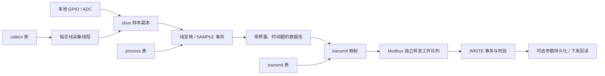

# collect / process / transmit 模块设计

本轮参考 `/home/ryan/Documents/demo/MCUdemo/CODE` 的设备与三表组织方式，
按 `dataprocess`、`collect`、`transmit` 拆成独立 Zephyr 模块，使用
`dp_*`、`co_*`、`tr_*` 接口。实现设备模型复用、业务处理与存储解耦，以及采集
事件调度。运行时只依赖本应用及 West 清单固定的 Zephyr，不依赖参考工程目录。

## 参考设计与 IDU 对应关系

| 参考工程 | 设计含义 | IDU 实现 |
| --- | --- | --- |
| `app/cfg/inc/` | 信号身份和项目配置契约 | 点表契约在 `src/cfg/`；协议契约在 `src/communication/config/protocol_config.h` |
| `app/cfg/equip/dev_cfg.c` 的设备列表 | 多个实例复用同型号的表 | `src/cfg/device_config.c` 装配，`src/cfg/instances.h` 绑定实例 |
| `app/cfg/equip/table/*` | 采集、处理、转发分别声明 | `src/cfg/{collect,process,transmit}.c`，复用型号定义在 `mvio_model.h` |
| `app/process/*` 的业务回调 | 配置绑定行为，执行代码独立维护 | `src/process/` |
| `platform/inc/collect_lib.h` | 采集地址、周期、优先级和编码独立配置 | `co_cfg`、字段表、每总线采集线程 |
| `platform/inc/data_process.h` | 共享数据池、类型/范围、旧值、回调及多输出 | `dp_point_cfg`、`dp_process_ctx`、`dp_txn_*` |
| `platform/inc/transmit_lib.h` | 北向地址映射到设备和测点 | `dp_transmit_cfg`、`tr_*` |

参考工程 DSP1…32 共用模型表。IDU 使用编译期实例展开，生成既有引擎可直接
读取的 `const` 三表，采集字段数组在实例间共享。这样保留设备模型的源代码
复用，也避免在 GD32E505 RAM 中复制整套点定义。实例增加仍消耗 Flash 表空间
和对应的数据池、调度槽位，必须满足 Kconfig 上限。

参考工程的 DSP、UPP 和逆变器业务寄存器不属于 IDU 硬件接口。本轮复用其
组织方式，默认设备仍为既有 MV-IO 虚拟采集端；已有 AIDC 可选配置保持独立。

参考工程核心只有预编译 `platform/libs/plateform.lib`；本轮依据公开头文件与
应用调用重建接口语义，没有声称复制不可见的内部实现。按约定沿用
`dp_*` / `co_*` / `tr_*` 命名，使用 Zephyr 类型，不兼容旧库二进制 ABI。

| 参考接口 / 行为 | Zephyr 实现入口 |
| --- | --- |
| 数据池、旧值、输入集合、多输出、不递归回调 | `dp_read()`、`dp_process_execute()`、`dp_txn_get()` / `dp_txn_emit()` |
| `dp_para_reg_set_func` 注入下发方法 | `dp_params_set_transport()` 注入复制的读、写、模拟来源回调 |
| INIT 列表与 TIMER 注册 | `dp_process_start()`，显式键列表或全部初始化，定时器使用 `k_timeout_t` |
| 采集表、周期、优先级、端口状态 | `co_init_bus()`、`co_submit()`、`co_set_mode()` |
| `tr_reg_table_func`、SLAVE / SLEEP / CALLBACK | `tr_reg_table_func()`、`tr_set_port_mode()` |
| 包过滤与端口控制 | `tr_reg_pkt_filter_func()`、`tr_pkt_filter_config()`、`tr_mb_port_work_control()` |

设备和表在启动前静态注册，不提供参考平台的运行期 `dp_dev_add/del` 热插拔。
UPP、逆变器专用命令及其日志/加密扩展不属于通用三模块接口；不能据这些表的
组织方式推断相关协议已实现。有界事务或队列满时明确返回错误，不隐式提交
半批输出。

## 通讯点表的文件职责

`src/cfg/` 只保留点表相关配置，源码和头文件平铺。本地条目与导入点表直接
放在所属 `.c` 中。这里描述设备和信号、采集地址与编码、
处理绑定及寄存器到信号的映射。协议路由、控制命令和应用功能选项分别归属
通信层与 `src/Kconfig`；配置内容与功能保持不变，三模块内核保持独立。

| 位置 | 内容 |
| --- | --- |
| `src/cfg/signal_ids.h` | 应用设备 ID 和信号 ID；内部键不等同于报文地址 |
| `src/cfg/device_config.h` | 设备配置及三表获取接口 |
| `src/cfg/point_metadata.h` | 信号采集模型、处理绑定元数据的类型和获取接口 |
| `src/cfg/device_config.c`、`src/cfg/instances.h` | 装配三表；绑定型号实例的设备、总线、unit、北向窗口和周期 |
| `src/cfg/process.c` | 本地信号/参数与型号点装配；类型、默认值、存储属性及处理绑定 |
| `src/cfg/collect.c` | 南向读块、字段偏移、字序与周期参数 |
| `src/cfg/transmit.c` | 本地及型号的北向值、别名与质量映射 |
| `src/cfg/mvio_model.h` | MV-IO 信号 ID，以及采集、处理、转发三组复用宏 |
| `src/cfg/point_metadata.c` | 提供 `idu_collect_models()` 和 `idu_process_bindings()` 获取接口 |
| `src/cfg/generated/` | 仅保留导入符号 `symbols.h` 与来源诊断 `migration.json` |

点表之外，`src/communication/config/protocol_config.h` 声明协议配置契约，
同目录的 `protocol_config.c` 选择 MV-IO 路由或 AIDC 串口参数回调；
`parameter_config.c` 声明控制命令/诊断状态，`mvio_config.c` 声明兼容入口、
扩展窗口和旧回调表顺序。这些配置决定请求路由和动作分派；`transmit` 点表
描述寄存器与数据池信号的对应关系，二者需要配合维护。

`src/process/` 执行电流换算、参数操作、旧保存地址导入/校验和 AIDC 业务回调。
`src/communication/` 执行端口配置、解析/编码及路由，`ports/` 提供采集后端。
应用功能选项统一在 `src/Kconfig`，原符号和默认值保持不变。

`src/cfg/mvio_model.h` 集中维护型号信号 ID 和三组宏，三表分别展开所属定义。
`include/idu_equip.h` 继续聚合应用接口；新增配置代码使用 `src/cfg/` 中的对应头文件。

`src/cfg/point_metadata.c` 直接保存信号采集模型和处理绑定，类型分别为
`idu_collect_model`、`idu_process_binding`。
绑定的 `callback` 是原回调名称字符串，实际处理仍在 `src/process/` 执行。
现有生成数据来源于 AIDC；外部 `CONFIG_IDU_AIDC_PROFILE`、导入工具
`tools/import_aidc.py`、生成宏及业务函数名保留兼容，来源与版权记录保留。
导入工具的 `--output` 默认指向 `src/cfg`，更新各 `.c` 中成对的
`BEGIN IMPORTED TABLE` / `END IMPORTED TABLE` 区段，并保留区段外的手写内容。
7 组导入数据内联保存，支持范围和未实现动作的返回行为保持不变。

点序、默认值、flags、字序及 NVS schema 保持原样。MV-IO 的 `input/holding`
是按旧回调表顺序遍历的条目，允许读取时跳过地址空洞；它们不是连续寄存器段。
起始地址是否允许进入由独立的 `read_starts/write_starts` 决定，不能通过排序、
合并区间或改用普通连续映射来“整理”这套兼容行为。

## 数据流与模块边界



- **collect** 负责请求调度、总线互斥、报文校验和字段解码。输出为带来源标志
  的样本批次；通信失败使测点质量失效，不把上一次值冒充本次成功采样。
- **process** 负责纯数值变换、范围校验和 READ/WRITE/INIT/SAMPLE/TIMER
  业务回调。事务先收集完整输入，再运行回调；派生输出通过 `dp_txn_emit()`
  提交。回调使用事务访问器，不能重新调用引擎形成递归或锁循环。
- **transmit** 将独立的协议地址关联到 `(dev_id, sig_id)`。同一测点可有多个
  读地址；字序转换属于协议边界，数据池保持低字优先的主机字序。
- **params** 单独负责参数权限、持久化、下游设定值事务及恢复。现有参数源
  仍要求启用该后端，不会因关闭存储而悄悄退化为易失参数。
- **应用层** 保留本地 ADC 换算、MV-IO 兼容策略和设备配置；通用模块不引用
  板级 GPIO、设备专用寄存器或 BSP。生命周期继续由设备服务与运行层组织。

共享数据池并不保证任意多个测点组成的北向读响应来自同一次采样；当前仍是
逐测点读取。参数跨设备提交也不是分布式原子事务，错误及部分完成结果遵循
`dp_process_result`。本轮未改变这些既有契约。

## Zephyr 配置与调度

| 配置 | 职责 |
| --- | --- |
| `CONFIG_DATAPROCESS` | 有界数据池、zbus 样本副本、纯变换；不依赖 Modbus |
| `CONFIG_COLLECT` | 每总线采集、调度及可替换后端；依赖 Modbus client |
| `CONFIG_TRANSMIT` | 协议映射、寄存器读写；依赖 Modbus server |
| `CONFIG_DP_PROCESS` | 事务回调、复制式 `k_msgq` 异步任务、业务定时器；默认开启，无需 Flash |
| `CONFIG_DP_PARAMS` | NVS 参数存储、下发与回读恢复；自动启用 Process |
| `CONFIG_TR_MODBUS_ADAPTER` | 完整 PDU 路由及独立转发工作队列；无需 Process、NVS 或 collect |
| `CONFIG_CO_QUEUE_DEPTH` | 每条采集总线等待队列容量，默认 4 |
| `CONFIG_DP_PROCESS_STACK_SIZE` | 业务线程栈大小，默认 6144 字节 |

完整 IDU-pre 应用强制启用 Process 和 Modbus 适配层；通用模块的独立使用者
可以按需选择。关闭 Process 后仍可执行纯变换，声明业务回调的配置会在启动
校验时被拒绝。无参数后端时 `dp_process_save_reboot()` 返回 `-ENOTSUP`。

启动按数据池 → 注册采集后端 → 参数恢复 → `dp_process_start()` → 启动采集
组织。初始化计划先完整校验并预留定时器槽，全部 INIT 成功后再启用定时器；
失败释放预留槽，已成功的 INIT 事务不会回滚。成功后的重复启动返回
`-EALREADY`。IDU 默认初始化全部测点，业务按需增加定时器。

参数层不调用采集模块。`co_init_bus()` 注入 transport，其他应用也可自行
提供后端；无后端仍可使用本地 NVS，远端写在生成持久化意图前返回 `-ENODEV`。

转发端口的 SLEEP 在实际接收路径丢弃新请求，不运行过滤器或业务逻辑；已进入
处理的请求允许完成。CALLBACK 完全交由注册回调处理，不回落到普通写寄存器。
统计中的响应数表示已生成回复，不代表物理串口已经发送完成。

每条采集总线拥有专用线程、互斥锁和二值信号量。空闲时等到最近一个采集块
到期；提交请求、切换模式或启停采集会唤醒线程重新计算调度。SLEEP、初始化
独占期间及无周期任务时可无限等待，不再每 5 ms 扫描。优先级保留 0…3 和
老化补偿，进行中的报文不被抢占。队列满返回 `-ENOSPC`，调用者决定重试。

阻塞的 Modbus 事务留在采集线程或独立转发工作队列中，系统工作队列继续处理
Zephyr Modbus 接收。zbus 消息订阅者保存样本副本，避免仅通知通道地址导致
快速连续采样被覆盖。业务任务及定时器仍由独立线程运行，定时器不是硬实时
接口；本轮没有改变其 10 ms 检查节拍。

## 增加设备与业务

具体文件和操作步骤见 [`src/cfg/README.md`](../src/cfg/README.md)。
现有 MV-IO 型号在 `src/cfg/mvio_model.h` 中集中声明三组宏；
`IDU_MVIO_COLLECT_FIELDS` 只创建一份共享字段数组。

[`src/cfg/instances.h`](../src/cfg/instances.h) 的每行依次为：

```text
逻辑设备 ID，总线 ID，从机 unit，FC04 北向基址，FC03 地址读窗口，
快速采集周期，身份采集周期，快速测点过期时间，身份测点过期时间（时间均为 ms）
```

增加同型号实例时，同步分配设备 ID、总线和唯一北向窗口，并注册对应的
`co_init_bus()` 后端。实例行会展开设备注册与三表，不会创建物理串口或虚拟从机。
默认配置保留远端 10000…10023 与 30460，10012 为虚拟模式标志，10013 未定义。
**MV-IO 兼容入口的扩展窗口仍显式配置在 `src/communication/config/mvio_config.c` 中；新增实例
或点的北向地址不在现有窗口内时，还必须调整 `extensions[]` 并验证实际请求路由。**
仅增加 transmit 映射不能保证该地址可从串口访问。

新型号按三类职责建立自己的声明文件，再接入装配表与实例注册。采集块保持
显式连续，不跨设备未定义地址合帧；纯换算回调放在 `src/process/`，多输入/
输出业务使用既有 `handler` 和事务访问器。虚拟演示参数的下游 40000 等地址
不属于 MV-IO 型号，不应复制成真实设备协议。

## 验证入口

从工作区运行 `bash applications/IDU-pre/tests/run.sh`。新增：

- `tests/models`：同一模型两实例、跨总线相同 unit、采集到转发的宽度与地址、
  模拟标志、故障隔离及配置冲突。
- `tests/pipeline`：无 Flash/NVS 时的样本回调、多输出、READ/INIT、异步任务、
  定时器，以及实际 RAW Modbus 转发；分别验证适配层开启和关闭。
- `tests/pipeline` 的 `process-off.conf`：关闭业务引擎后纯变换、基础转发和
  错误质量仍生效，并拒绝未启用的业务回调。
- `tests/collector`：队列容量、优先级老化、模式切换唤醒、周期截止时间、
  初始化独占及失败恢复。
- `tests/dataprocess`：仅注册核心模块，分别覆盖无存储、本地 NVS、注入后端，
  以及 INIT 顺序、失败重试和定时器容量。
- `tests/transmit`：关闭 collect、Process、NVS，真实 RAW 请求验证休眠、唤醒、
  回调模式、过滤、端口隔离和统计。

原 points、AIDC、MV-IO、IAP、启动与运行层回归继续执行。目标板通过
`./applications/IDU-pre/build.sh` 交叉编译并检查旧 BOOT 镜像布局。
模拟器验证不代替实际串口时序、调度延迟和设备掉线恢复的上板验证。

既有模块拆分验证记录（2026-10-19，非本次文件内容重构的新结果）：完整 `tests/run.sh`、默认固件、MCUboot/IAPv3 构建与
签名验证通过；另导出暂存区单独交叉编译，确认提交不依赖工作区已有的未提交
运行层改动。运行环境使用 `CCACHE_DISABLE=1`；主机测试使用
`ASAN_OPTIONS=detect_leaks=0` 绕过沙箱 ptrace 限制，保留 ASan/UBSan 检查。
该记录未包含实板测试。

通讯点表文件重构验证（2026-10-19）：完整 `tests/run.sh`、默认固件及
MCUboot/IAPv3 构建、签名校验通过。补充 profile 绑定及双字命令拒绝用例后，
重新运行 points、AIDC、MV-IO 及参数重启恢复测试，全部通过。暂存代码单独
交叉编译及启动镜像布局检查通过，不依赖未提交的运行层改动。沿用上述沙箱
环境配置；本次未进行实板测试。

前次配置目录迁移验证（2026-10-19）：原 `cfg/` 的 31 个文件全部迁入 `src/cfg/`，
9 个 AIDC 生成文件逐字节一致，配置数据与执行逻辑保持不变。完整回归、默认
固件、MCUboot/IAPv3 构建及签名校验通过；暂存代码独立构建与启动布局检查
通过。导入工具的默认输出已核对为新目录，参考来源路径保持原样。沿用上述
沙箱测试设置，本次未进行实板验证。

点表目录职责调整验证（2026-10-19）：`src/cfg/` 保留的 24 个点表源码及数据
文件逐字节一致，迁出的协议配置和 Kconfig 保持原值与行为。完整回归、默认
固件、MCUboot/IAPv3 构建和签名校验通过，暂存代码独立构建及启动布局检查
通过。沿用上述沙箱设置，本次未进行实板验证。

前次点表功能命名调整验证（2026-10-19）：9 份生成数据逐字节不变，导入工具默认
输出已核对为 `src/cfg/tables/generated/`。完整回归及默认固件构建通过；另将
暂存内容单独导出，构建并运行导入点表配置的 native_sim 测试，3 项全部通过。
沿用上述沙箱设置，本次未进行实板验证。
