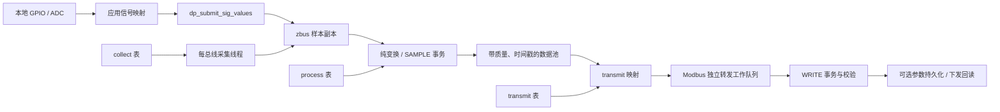

# 采集、处理与转发架构

[文档导航](README.md) · [点表维护](../app/cfg/README.md) · [模块接口](../modules/README.md)

架构参考 `/home/ryan/Documents/demo/MCUdemo/CODE` 的设备与三表组织方式，
按 `dataprocess`、`collect`、`transmit` 拆成独立 Zephyr 模块，使用
`dp_*`、`co_*`、`tr_*` 接口。实现设备模型复用、业务处理与存储解耦，以及采集
事件调度。运行时只依赖本应用及 West 清单固定的 Zephyr，不依赖参考工程目录。
这三个模块负责点表数据链；独立的 `modules/quicklz` 提供纯 C 解码能力。

## 参考设计与 IDU 对应关系

| 参考工程 | 设计含义 | IDU 实现 |
| --- | --- | --- |
| `app/cfg/inc/` | 信号身份和项目配置契约 | 点表契约在 `app/cfg/devices/`、`app/cfg/tables/`；协议契约在 `app/communication/config/protocol_config.h` |
| `app/cfg/equip/dev_cfg.c` 的设备列表 | 多个实例复用同型号的表 | `app/cfg/devices/device_config.c` 装配，`app/cfg/devices/instances.h` 绑定实例 |
| `app/cfg/equip/table/*` | 采集、处理、转发分别声明 | `app/cfg/tables/{collect,process,transmit}.c`，复用型号定义在 `app/cfg/devices/mvio_model.h` |
| `app/process/*` 的业务回调 | 配置绑定行为，执行代码独立维护 | `app/process/` |
| `platform/inc/collect_lib.h` | 采集地址、周期、优先级和编码独立配置 | `co_cfg`、字段表、每总线采集线程 |
| `platform/inc/data_process.h` | 共享数据池、类型/范围、旧值、回调及多输出 | `dp_point_cfg`、`dp_process_ctx`、`dp_txn_*` |
| `platform/inc/transmit_lib.h` | 北向地址映射到设备和测点 | `dp_transmit_cfg`、`tr_*` |

参考工程 DSP1…32 共用模型表。IDU 使用编译期实例展开，生成既有引擎可直接
读取的 `const` 三表，采集字段数组在实例间共享。这样保留设备模型的源代码
复用，也避免在 GD32E505 RAM 中复制整套点定义。实例增加仍消耗 Flash 表空间
和对应的数据池、调度槽位，必须满足 Kconfig 上限。

参考工程的 DSP、UPP 和逆变器业务寄存器不属于 IDU 硬件接口。这里复用其
组织方式，默认设备仍为既有 MV-IO 虚拟采集端；已有 AIDC 可选配置保持独立。

参考工程核心只有预编译 `platform/libs/plateform.lib`；实现依据公开头文件、
应用调用和选定函数的静态反汇编重建接口语义。按约定沿用
`dp_*` / `co_*` / `tr_*` 命名，使用 Zephyr 类型，不兼容旧库二进制 ABI。

| 参考接口 / 行为 | Zephyr 实现入口 |
| --- | --- |
| `dp_set_sig_value` 设置测点 | `data_process.h` 保留四参数、字节长度及同步回调；异步遥测使用 `dp_submit_sig_value()` / `dp_submit_sig_values()` |
| 数据池、旧值、输入集合、多输出、不递归回调 | `dp_read()`、`dp_process_execute()`、`dp_txn_get()` / `dp_txn_emit()` |
| 直接下发与持久化后端 | `dp_para_reg_set_func()` 用于 `dp_set_para_not_dm()`；`dp_params_set_transport()` 提供 NVS 事务的读/写/来源回调 |
| INIT 列表与 TIMER 注册 | 按点计划 `dp_process_start()`；原全局表 `dp_reference_start()`；按设备重初始化 `dp_set_init()` |
| 采集表、周期、优先级、端口状态 | `co_init_bus()`、`co_submit()`、`co_set_mode()` |
| `tr_reg_table_func`、SLAVE / SLEEP / CALLBACK | `tr_reg_table_func()`、`tr_set_port_mode()` |
| 包过滤与端口控制 | `tr_reg_pkt_filter_func()`、`tr_pkt_filter_config()`、`tr_mb_port_work_control()` |

设备和表在启动前静态注册，不提供参考平台的运行期 `dp_dev_add/del` 热插拔。
UPP、逆变器专用命令及其日志/加密扩展不属于通用三模块接口；不能据这些表的
组织方式推断相关协议已实现。有界事务或队列满时明确返回错误，不隐式提交
半批输出。

## 配置与应用分工

| 位置 | 职责 |
| --- | --- |
| `app/cfg/devices/` | 设备实例、型号复用与三表装配 |
| `app/cfg/tables/` | 信号、采集/处理/转发表和来源元数据 |
| `app/process/` | 纯换算、事务业务回调、参数命令和旧参数导入 |
| `app/communication/config/` | 协议路由、兼容窗口、控制/诊断寄存器 |
| `app/communication/ports/` | 虚拟或真实采集后端 |
| `app/` | 初始化装配、本地样本映射和健康确认 |
| `app/acquisition/` | 采集业务状态、统一原始采样入口及产品配置；调用三个通用硬件服务模块 |

配置只声明数据和绑定，通用模块不引用本板 BSP 或设备专用寄存器。
文件清单与新增设备步骤集中在[点表维护指南](../app/cfg/README.md)。
原表、库证据和接口限制集中在[参考平台对照](reference-platform.md)。

## 数据流与模块边界

- **collect** 负责请求调度、总线互斥、报文校验和字段解码。输出为带来源标志
  的样本批次；通信失败使测点质量失效，不把上一次值冒充本次成功采样。
- **process** 负责纯数值变换、范围校验和 READ/WRITE/INIT/SAMPLE/TIMER
  业务回调。事务先收集完整输入，再运行回调；派生输出通过 `dp_txn_emit()`
  提交。回调使用事务访问器，不能重新调用引擎形成递归或锁循环。
- **transmit** 将独立的协议地址关联到 `(dev_id, sig_id)`。同一测点可有多个
  读地址；字序转换属于协议边界，数据池保持低字优先的主机字序。
- **params** 单独负责参数权限、持久化、下游设定值事务及恢复。现有参数源
  仍要求启用该后端，不会因关闭存储而悄悄退化为易失参数。
- **应用层** 保留本地 ADC 换算、MV-IO 兼容策略和设备配置；通用模块不引用
  板级 GPIO、设备专用寄存器或 BSP。生命周期继续由设备服务与运行层组织。

`app/process/points.c` 集中点表初始化、采样映射及公共回调，保留
`idu_equipment_init()` 函数名；`app/process/engineering.c`
负责工程值换算。这些职责直接依赖 IDU 配置及硬件语义，属于应用层。
点表机制由 `dataprocess`、`collect`、`transmit` 提供，不另设 equipment 模块。

`modules/quicklz` 是另外一个独立模块，通过 `CONFIG_QUICKLZ` 启用
`quicklz/quicklz.h` 的 `qlz_decode_level3()`。解码器不依赖硬件、加密或 Zephyr
运行时；SGZ 容器和镜像校验归 [`modules/iap`](../modules/iap/README.md)，
分区、密钥来源、内存范围和保存策略通过设备树与 Kconfig 配置。

共享数据池并不保证任意多个测点组成的北向读响应来自同一次采样；当前仍是
逐测点读取。参数跨设备提交也不是分布式原子事务，错误及部分完成结果遵循
`dp_process_result`。详细事务边界见[模块接口](../modules/README.md#process-and-parameter-contracts)。

## Zephyr 配置与调度

| 配置 | 职责 |
| --- | --- |
| `CONFIG_DATAPROCESS` | 有界数据池、zbus 样本副本、纯变换；不依赖 Modbus |
| `CONFIG_COLLECT` | 每总线采集、调度及可替换后端；依赖 Modbus client |
| `CONFIG_TRANSMIT` | 协议映射、寄存器读写；依赖 Modbus server |
| `CONFIG_DP_PROCESS` | 事务回调、复制式 `k_msgq` 异步任务、业务定时器；默认开启，无需 Flash |
| `CONFIG_DP_PARAMS` | NVS 参数存储、下发与回读恢复；自动启用 Process |
| `CONFIG_TR_MODBUS_ADAPTER` | 完整 PDU 路由及独立转发工作队列；无需 Process、NVS 或 collect |
| `CONFIG_CO_QUEUE_DEPTH` | 每条采集总线等待队列容量，默认 4 |
| `CONFIG_DP_PROCESS_STACK_SIZE` | 业务线程栈大小，默认 6144 字节 |

完整 IDU-pre 应用强制启用 Process 和 Modbus 适配层；通用模块的独立使用者
可以按需选择。关闭 Process 后仍可执行纯变换，声明业务回调的配置会在启动
校验时被拒绝。无参数后端时 `dp_process_save_reboot()` 返回 `-ENOTSUP`。

应用在 `app/process/points.c` 显式组织启动：`dp_init()` → 创建应用采集接口 →
`co_init()` / `co_init_bus()` 注册全部总线 → `dp_params_init()` / 恢复参数 →
`dp_process_start()` → `dp_reference_start()` → `co_start()`。参数存储失败后的降级策略由应用决定。
首轮采样地址就绪后，再由通信层绑定转发接口；不使用 `SYS_INIT` 安排这些步骤。
初始化计划先完整校验并预留定时器槽，全部 INIT 成功后再启用定时器；
失败释放预留槽，已成功的 INIT 事务不会回滚。成功后的重复启动返回
`-EALREADY`。IDU 默认初始化全部测点，业务按需增加定时器。

参数层不调用采集模块。`co_init_bus()` 注入 transport，其他应用也可自行
提供后端；无后端仍可使用本地 NVS，远端写在生成持久化意图前返回 `-ENODEV`。

转发端口的 SLEEP 在实际接收路径丢弃新请求，不运行过滤器或业务逻辑；已进入
处理的请求允许完成。CALLBACK 完全交由注册回调处理，不回落到普通写寄存器。
统计中的响应数表示已生成回复，不代表物理串口已经发送完成。

每条采集总线拥有专用线程、互斥锁和二值信号量。空闲时等到最近一个采集块
到期；提交请求、切换模式或启停采集会唤醒线程重新计算调度。SLEEP、初始化
独占期间及无周期任务时可无限等待，不再每 5 ms 扫描。优先级保留 0…3 和
老化补偿，进行中的报文不被抢占。队列满返回 `-ENOSPC`，调用者决定重试。

阻塞的 Modbus 事务留在采集线程或独立转发工作队列中，系统工作队列继续处理
Zephyr Modbus 接收。zbus 消息订阅者保存样本副本，避免仅通知通道地址导致
快速连续采样被覆盖。业务任务及定时器仍由独立线程运行，定时器不是硬实时
接口，检查节拍为 10 ms。

## 使用与验证

- [本地采样、事务与参数后端](../modules/dataprocess/README.md)
- [CO/TR 调度、端口与协议接口](../modules/README.md#collection-and-forwarding)
- [修改测点、型号与实例](../app/cfg/README.md#修改设备或测点)
- [测试入口及已记录验证](testing.md)

完整回归与各套件职责已移至[验证说明](testing.md#覆盖入口)。
