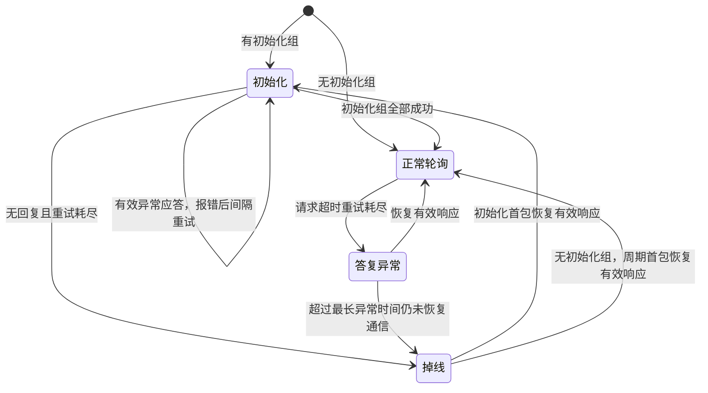

# 采集与转发重构方案

状态：2026-10-22，10 项实施任务已完成，完整主机/native 回归和固件构建、验签、导出均通过。依据[正式规格](../.scratch/communication-boundaries/spec.md)；逐项结果见[实施验证](../.scratch/communication-boundaries/validation.md)。
本文件描述当前接口和边界；实物时序、性能与掉电验证仍须单独进行。
决策依据见 [ADR 0007](adr/0007-protocol-assembly-lifecycle.md)、[ADR 0008](adr/0008-southbound-offline-polling.md)，
问答过程见[边界讨论](../.scratch/communication-boundaries/discussion.md)。

## 职责与装配

| 位置 | 职责 |
| --- | --- |
| `main` | 调用统一的协议初始化入口，保留本地采样周期及整机启动编排。 |
| `app/protocol` | 组合数据设备、点表、协议角色和端口；显式注册 CO/DP 双向回调，创建并编排 DP/CO/TR 执行上下文，连接状态通知。 |
| DP | 测点值、质量、处理回调与参数事务；提供初始化、处理与任务调用能力。 |
| CO | 协议客户端、组包、请求调度、设备状态机和自动采集重试；不隐式安装 DP 后端或创建任务。 |
| TR | 协议服务端、北向映射及转发处理；不依赖本地采样循环完成首次启动或日常通信维护。 |
| vport 与应用端口编排 | vport 保持协议无关的报文端口能力；实际硬件收发、物理资源互斥和映射由应用接入实现。 |
| `app/status` | 接收协议层接入的状态，决定显示、整机健康和看门狗策略。 |

协议解析仍由通用模块提供，应用只做组合。数据设备和虚拟转发入口继续分离，
不恢复用本地数据设备代替转发入口的设计。
模块保留队列等待、周期计算和状态机，应用不逐点遍历采集表。
采集阶段、周期到期、重试预算和恢复后的推进集中在 CO 内部状态实现；
总线任务只进行请求竞争、通信执行和等待，不再次解释在线/离线状态。
公共 Modbus 接入和转发扩展的依赖见 [ADR 0010](adr/0010-collection-decisions-and-modbus-support.md)。
后续 status 如需观察采集状态，由 status 主动查询 collect；本轮不新增该调用，保留现有状态接入。
本次任务所有权调整范围是 DP/CO/TR 自有执行上下文，不接管 Zephyr 内核或子系统内部线程。

## 本地初始化与运行

统一协议初始化完成配置检查、模块与端口装配、CO/DP 回调连接、参数加载/恢复处理以及站号设置，
最后统一放行应用创建的任务。模块初始化不隐式启动这些任务，周期服务不兼任首次初始化。
参数后端必须先绑定，再处理参数加载与未决恢复；IAP 路由开放前必须满足 IAP 初始化前置条件。

本地初始化不等待远端上线。远端初始化采集由运行任务推进，设备无回复通过设备状态机处理。
站号在本地初始化阶段取得，由 protocol 决定来源；当前可以写死。
DP/GPIO 等是以后可选择的来源，不引入运行期等待地址或自动来源切换机制。

CO 样本交付 DP 时复制并异步入队，成功表示已接受，不表示已处理。
DP 到 CO 的下发/读回同步返回受超时限制的实际结果，不能将北向写完成改成仅入队。
双向处理函数允许直接使用模块导出的函数，不强制增加应用转调包装。
迁移时须保持数据生命周期和有界等待，避免持有参数事务锁时经回调再次进入参数接口或循环等待。

## 两组采集报文

- 初始化组：带初始化标记，每次设备正式上线时执行一次，完成后进入正常轮询。
- 正常轮询组：按各点配置的毫秒周期调度。

组包按点表声明顺序，只合并同设备、同功能码、同采集阶段且周期兼容的连续寄存器，
不跨地址空洞，超过协议长度则拆包。“第一包”指该顺序组包后的首包。

没有初始化组时直接正常轮询，掉线探测使用该设备第一包正常周期读。
有初始化组时，掉线探测只发送初始化第一包；首包成功后继续后面的初始化包，不重复发送已成功首包。
初始化出错不跳过失败包，也不提前进入正常轮询。

## 每设备状态机

掉线探测首包若返回有效异常应答，说明通信已恢复，但初始化仍失败，按初始化报错路径处理，
不能因此宣布所有测点已经可用。无初始化组时，有效异常应答同样只证明通信存在，操作错误仍保留。

正常轮询进入答复异常后仍保持原轮询周期。尚未正式掉线时恢复有效响应，直接回正常轮询，不重新初始化。
正式掉线后才降低频率，按探测间隔发第一包；恢复后有初始化组的设备重新执行初始化阶段。
离线探测每周期只尝试一次，不使用正常初始化和轮询的额外重试预算。
当前应用在 `prj.conf` 设置 `CONFIG_IDU_COLLECT_PROBE_MS=30000`；每设备的
`co_device_policy.probe_ms` 定义一次失败探测结束到下一次开始的间隔。
应用监听设备事件，仅在状态变化时打印；底层逐次接收超时保留为调试级日志。
正常轮询收到有效 Modbus 异常应答只记录操作错误，不因它进入无回复异常或掉线。
本地忙、队列满等未实际发出的请求不作为设备无回复，同一次实际请求不重复更新最终结果计数。

每设备显式配置自动采集重试次数、最大异常持续时间和掉线探测间隔。
初始化与正常轮询共用重试次数，但耗尽后的状态转移不同；配置值可由 `.conf` 提供。
线程栈和容量继续手动配置，不按固件类型预设或预留未来资源；实际数值由 `prj.conf` 手动设置。
IAPv3 将共用的 Modbus 缓冲区扩为 1100 B，旧版本嵌套栈上缓冲曾触发栈保护。
当前大请求、任务副本和 RAW 帧已使用 `k_malloc()`，采集栈恢复为 4096 B；
分配生命周期、堆预算及实板验证边界见[内存管理](memory-management.md)。

## 下发、缓存与错误

显式下发不自动重试，包括非持久命令；失败不触发答复异常状态。
每次 ADU 交换的总预算由 `CONFIG_CO_EXCHANGE_TIMEOUT_MS` 设置，产品当前为
500 ms，包含 CO 总线锁、共享物理口锁、RAW 事务锁、Zephyr 接口锁、发送和响应；
不包含业务队列排队、DP 处理或持久事务的其他报文。响应仍最多等待
`CONFIG_CO_TIMEOUT_MS`（当前 100 ms），总预算先到期时提前结束。自动重试各自
重新计时。`co_bus_cfg.transfer` 接收剩余时间，后端必须遵守；未发送的竞争
超时返回 `-EBUSY`，不计远端无回复。回调无法由内核强行打断，新的后端也须测试此契约。
离线设备仍允许尝试一次受超时限制的完整操作。持久设置保留既有意图日志、下发、读回及未决恢复规则，
不将事务简化成单帧发送，也不因重新上线自动重放非持久命令。

设备掉线时，其 CO 采集点统一标为通信失效，保留最后值；北向读取失效点返回协议异常。
已保存参数目标不删除，不能将采集反馈覆盖成新的持久目标。
重新上线后，每个测点收到成功采样才恢复有效，不仅凭设备上线就使全部缓存有效。
本地测点、其他设备采集及北向服务继续运行；对端掉线本身不停止整机喂狗。

错误记录及统计保存在 RAM，模块提供读取和清理能力，由应用主动调用。
成功通信不自动清掉历史错误；清理只清记录和统计，不改变状态、测点质量或触发初始化/命令重放。
北向离线判断暂不实现，后续由 protocol 编排。

## 存储故障与迁移约束

参数存储不可用时继续本地采样、南向采集及北向读取，同时报告存储故障；
需要持久保存的写入明确失败，不返回虚假的保存成功。
IAP 保留保存参数失败时不继续升级提交或重启的约束。

本次重构保留现用 dp_/co_/tr_ 业务语义、点表关联、NVS 数据键/格式和 IAPv3 线协议。
实际装配在 `app/protocol/init.c`，执行上下文在 `tasks.c`；对应公开接口及配置见下表。

验证应覆盖状态转移、组包边界、初始化失败、失效与逐点恢复、无显式重试、回调完成语义、
启动放行及存储故障降级。主机/模拟器结果与实物 RS485 时序和性能验证分别记录。

## 当前接口与运行配置

| 入口 | 调用方及作用 |
| --- | --- |
| `protocol_init()` | main 调用；本地装配、存储加载/恢复、计划、转发初始化和统一任务放行。 |
| `dp_samples_task()` / `dp_business_task()` | 应用创建的样本和业务线程入口。 |
| `co_set_data_callbacks()` | 应用注册 `dp_accept_samples`、显式初始化后处理和 `dp_invalidate_acquired_device`。 |
| `dp_params_set_transport(co_parameter_transport())` | 显式绑定同步南向读写，须早于参数恢复。 |
| `co_set_device_policy()` / `co_polling_init()` / `co_bus_task()` | 每设备常驻策略、检查并启用调度、每实际总线的任务入口；不隐式创建线程。 |
| `tr_modbus_bind_execution()` / `tr_forward_init()` | 绑定应用接收/配置队列，显式装配指定北向入口。 |
| `tr_forward_service()` | 应用配置队列周期维护；未初始化返回 ENODEV。 |
| `co_device_status()` / `co_clear_device_errors()` | 一致 RAM 快照 / 只清诊断和请求计数；清理不改变调度与质量。 |
| `co_device_status()` / `dp_params_get_status()` | 直接读取所属模块的设备状态与参数存储诊断，不再汇总复制到 status。 |

北向站号 `CONFIG_IDU_FORWARD_UNIT=16`，南向站号 1、2，共用物理 RS485。
自动采集额外重试 2 次，异常最长 3000 ms，掉线首包单次探测间隔 30000 ms；
均由 `.conf` 显式设置，通用 CO 接口允许每设备不同策略。北向不做离线检测。
上线自动采集不调用业务 INIT 或同步已保存目标；显式 `co_initialize_device()` 才执行已注册的初始化后处理。
掉线失效直接更新缓存质量并设置时间屏障，避免排队旧样本恢复质量；持久参数目标独立保留。
