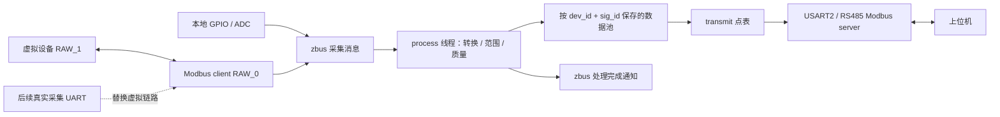

# 点表、寄存器与参数事务

[文档导航](README.md) · [架构设计](collect-process-transmit.md) · [点表维护指南](../src/cfg/README.md)

本页描述 IDU 的点值/质量、北向寄存器、参数持久化及采集后端配置。
文件职责和新增点步骤集中在[点表维护指南](../src/cfg/README.md)，
原平台接口覆盖集中在[参考平台对照](reference-platform.md)。
MV-IO 的 247、广播、有序旧表和保存地址规则见[兼容说明](mvio-compatibility.md)。
历史迁移和旧库分析见[迁移记录](migration-history.md)。

## 运行链路



用户已确认：**现有 USART2/RS485 转发，缺少的一路作为采集口**。
USART0 仍是日志控制台。

- 本地采集在主线程；Modbus 采集每总线使用独立线程，按块配置周期轮询。
- 采样消息由处理线程消费；同步业务 API 在调用线程执行，异步请求和
  TIMER 回调由独立业务线程执行。回调应遵守各自的锁和重入约束。
- 北向转发使用优先级 6 的独立工作队列；南向接收仍用系统工作队列。
  参数写回调可以等待南向 Modbus，避免在系统工作队列内自锁。
  普通读读取缓存；声明 `read_callback` 的点通过 process 读回调生成值。
  同一北向接口按请求串行处理，正在执行的参数
  写事务会占用该接口到成功或失败，不承诺写事务期间并行处理读请求。
- 处理线程使用 zbus **message subscriber** 接收消息副本，避免不同
  来源的采集批次被“只读最新频道值”的方式覆盖。
- 一个采集块在持锁期间整体更新；不同轮询块可以有不同采样时间。
  `tr_read_register()` 提供单寄存器映射读取，`tr_read()` 提供带来源端口的
  多寄存器读取；二者均在 `transmit/transmit.h`，不属于 dataprocess。
  按信号键读取使用 `dp_read()`。不承诺任意线程配置下整张点表的多寄存器
  事务快照；参数内部缓存提交受同一互斥锁保护。
- 默认最多排队 6 批，批次最多 12 点，每点最多 16 个 16 位字。
  采集频道使用独立固定缓冲池，发布 API 用信号量预留容量、互斥锁
  串行发布；队列满时按指定超时返回错误。没有动态分配采集消息。
- `dp_processed_chan` 是可合并的处理完成通知，可加普通 subscriber
  或快速 listener。不要给它添加保留消息副本的 message subscriber，
  也不要绕过 `dp_publish()` 直接发布内部采集频道。
- 主循环同时检查处理线程进展；本地发布失败或处理停滞会停止喂狗。
  下游掉线只改变远程测点质量，不使本地采集或上位机转发停止。

### 点值与质量

支持 `U8/U16/S16/U32/S32` 和定长字数组。字符串用字数组表示，每个
寄存器的高字节在前；字符串字序与数值的高低字顺序是不同概念。
32 位数值在数据池内统一低字在前，采集和转发表可分别指定高字或低字在前。
Modbus 每个寄存器的线缆字节序由 Zephyr 协议栈处理。

常量使用配置默认值且立即有效。运行时采集点从 UNINITIALIZED 开始，
不能用默认的 0 冒充有效采样。数据质量低字节定义如下：

| 值 | 含义 |
| --- | --- |
| 0 | GOOD，有效 |
| 1 | UNINITIALIZED，尚未采集 |
| 2 | COMM_ERROR，本次采集失败 |
| 3 | STALE，已超过该点的 `stale_ms` |
| 4 | BAD_VALUE，转换失败或数值超范围 |

`0x0100` 是 **SIMULATED** 来源标记，与质量按位组合。例如虚拟点正常
是 `0x0100`，虚拟点通信失败是 `0x0102`。成功采集后恢复 GOOD。
失败时可在内部保留上次值用于诊断，但普通 Modbus 数据读取返回异常，
不会把旧值当成新值。`sampled_at/generation/error` 可经内部读取 API 获取。

Zephyr 4.4.2 的标准输入/保持寄存器读回调把应用读错误统一转换成
异常码 `02`。因此未知地址、无效值和过期值在线上都可能返回 `02`，
具体原因读取下面的质量寄存器。参数写入使用后述的整包适配。

## IDU-pre 配置和寄存器

本地设备 `dev_id=1`，远程 IO 设备 `dev_id=10`。二者可以有相同
`sig_id`，不会覆盖；远程从机地址在 `src/cfg/devices/instances.h` 中配置，当前为 1。
上位机访问 IDU 的地址仍由板上拨码决定（1–16）。

原有 8149–8199 等本地寄存器和 SN/版本别名保留。电流换算从主循环
移入处理回调，原始 ADC 值大于 4095 时拒绝，转换后仍按 16 位饱和。
`tests/legacy_registers.c` 冻结的是本项目早期 Zephyr 映射，仅验证点表
重构前后的一致性；它没有执行旧 MV-IO 代码，不能证明与旧真机协议
等价，也不参与固件链接。普通映射在三表中，命令/状态及兼容入口另有显式配置。

以下是新增的 **原始报文地址**，不减 1：

| 功能码 | 地址 | 内容 |
| --- | --- | --- |
| 04 | 10000 | 远程 DI 位图 |
| 04 | 10001–10008 | 远程八路电流，单位 0.01 A |
| 04 | 10009 | 远程 DI 的质量 |
| 04 | 10010–10011 | 远程协议号，低字在前 |
| 04 | 10012 | 采集后端：1 虚拟，0 真实 RTU |
| 04 | 10014–10021 | 八路远程电流各自的质量 |
| 04 | 10022 | 远程协议号的质量 |
| 04 | 10023 | 远程地址点的质量 |
| 03 | 30460 | 远程设备报告的通信地址 |

10013 没有定义；一次读请求跨过它会返回异常。03/30459 已恢复为本机
保存地址，读写并持久化；实际通信 unit 仍来自拨码。
这些新增地址是本项目的扩展，不是从 AIDC 旧协议推断出的兼容地址。

虚拟从机默认返回 DI=`0x0005`，八路电流为 `100,200,...,800`，协议号
`0x01000101`。这些是固定的测试数据，与板上真实 ADC 无关。
`idu_virtual_set_register()` 可修改测试值；`idu_virtual_set_online(false)`
让客户端真实等待超时。启动日志明确输出 VIRTUAL。

采集表分四块：DI、电流每 500 ms；协议号、远程地址每 5000 ms。
周期从上次完成开始计算；失败在下个周期重试，不做无间隔重试。
默认响应超时 100 ms，经接口转换为 Zephyr Modbus 所需的微秒。
修改 `CONFIG_CO_TIMEOUT_MS` 时要同时评估总线负载和点的过期时间。

### 修改点表

新增测点、实例、映射和持久点迁移按[点表维护指南](../src/cfg/README.md#修改设备或测点)执行。
三表与设备表具有静态生命周期，基础配置为 const；运行时默认/范围覆盖使用有界 RAM
槽位，见[Flash/RAM 分工](reference-platform.md#点表的-flash--ram-分工)。

## 第二路串口补上后

1. 按实际原理图在板级设备树/overlay 配置第二路 UART、pinctrl、DE
   GPIO 及 `current-speed`。UART 下添加 `compatible = "zephyr,modbus-serial"`
   的子节点，用 `idu-collect` alias 指向这个子节点。
2. 现有 `idu-forward` alias 继续指向 USART2 的 `modbus0`。
   代码会检查两者不共用 UART，也不能占用日志控制台。
3. 按实际下挂设备修改采集点表、从机地址和串口格式。当前真实后端
   默认 8N1，波特率取采集 UART 的设备树配置。
4. 在工作区根目录构建：

```bash
./applications/IDU-pre/build.sh -- \
  -DEXTRA_CONF_FILE=conf/collect-rtu.conf \
  -DDTC_OVERLAY_FILE=/absolute/path/to/actual-hardware.overlay
```

未补充 alias/硬件定义时真实后端会编译失败，不会自动抢用某个空闲串口。
切换回来应显式清理配置：

```bash
./applications/IDU-pre/build.sh -p always
```

点表引擎、zbus 消息和上位机映射都不需要因为串口替换而重写。
若真实下挂设备不是 MV-IO，则应按其协议修改三张表。

## 参数下发与持久化

### 点表与 API

`DP_SOURCE_PARAMETER` 与采集点分开，表示期望配置，而非实时反馈。
`param_flags` 支持 WRITE（可写）、PERSIST（保存）、RESTORE（可恢复
默认）、FORWARD（下发）。转发参数必须持久化，并指定从机设备、
`write_address`、`write_order`。`prepare_write` 只能校验/变换候选值，
不得 I/O、修改外部状态或递归调用点表 API。全部点校验通过后才产生
Flash 或总线操作；校验变换后的数值也再次检查范围。

- `dp_process_execute()` / `dp_process_submit()`：业务层按键写入并运行
  事务 handler；北向整点写入由 `tr_write()` 解析映射后进入该流程。
- `dp_params_set_values()`：按 `{dev_id,sig_id}` 批量设置的底层参数接口，
  执行权限、校验和持久化事务，但绕过业务 handler。
- `dp_params_write_registers()`：按 FC03 映射调用底层参数事务，绕过业务
  handler；正常北向 FC06/16 使用 transmit 的 `tr_write()`。
- `dp_params_restore(dev_id)`：只恢复标记 RESTORE 的点，经过同样的下发与保存路径。
- `dp_params_flush()`：同步保存持久目标值，包括待提交的延后保存值。
  普通持久写同步保存；`DP_OP_DEFER` / `DP_PARAM_DEFER_STORE` 使用 1 s 防抖，
  `DP_OP_NO_STORE` 的暂态值不会进入后续快照。
- `dp_params_recover()`：只回读待确认事务，绝不自动重发写命令。
- `dp_params_reload()`：在业务调用静止时重挂载并重读存储；不通过普通 Modbus 开放。

参数 API 是线程同步 API，不能从 ISR、系统工作队列或准备回调调用。
事务锁冲突返回 busy；不隐式排队或自动重试。完成后通过
`dp_param_events` 发布状态通知，使用普通 subscriber/快速 listener；
不要绑定保留消息副本的 message subscriber。通知可合并/丢弃，业务
以函数返回值和 `dp_params_get_status()` 为准；listener 不得重入参数 API。

上位机一次可写最多 32 个寄存器，参数点上限默认 16，每点最多 16 字。
32 位数/标签必须完整写入。请求可以包含多个本机参数，或者同一
下游设备上连续且完整的一组参数；禁止混合本机/下游、跨从机或跨
下游地址空洞，不通过拆分多笔写入来伪装跨设备原子事务。
转发参数只适用于**可回读的绝对设置值**，不能用于启动脉冲、清零、
计数加一等一次性命令。南向参数写入必须由本模块统一负责。

### 新增寄存器

下表地址均为报文原始地址，不减 1。FC16 即十进制 16 / 十六进制 0x10。

| 地址 | 读取/写入 | 内容 |
| --- | --- | --- |
| 31000 | FC03 / FC06 或 FC16 | 本机采样周期，100–1000 ms，默认 500；下一轮主循环采用新值 |
| 31001–31008 | FC03 / 完整 FC16 | 16 字节设备标签，默认 `IDU-pre`，每字高字节在前、尾部补 0；不改变旧 SN |
| 31500 | FC03 / FC06 或 FC16 | 虚拟设备设定值 0–1000，默认 100；下游 40000 |
| 31501–31502 | FC03 / 完整 FC16 | 虚拟 S32 偏移，−100000 至 100000，默认 0，低字在前；下游 40001–40002 |
| 31090 | FC06，写 0xA55A | 恢复本机默认参数并保存 |
| 31091 | FC06，写 0xA55A | 恢复虚拟下游默认参数，下发、回读并保存 |
| 31092 | FC06，写 1 | 同步保存当前参数 |
| 31093 | FC06，写 1 | 尝试回读恢复待确认事务 |
| 32000 | FC03，只读 | 状态位：bit0 存储可用，bit1 待确认事务，bit2 从历史记录恢复，bit3 已知格式升级 |
| 32001 | FC03，只读 | 最近完成的参数操作错误，S16，0 成功，负值为当前 Zephyr errno |
| 32002–32003 | FC03，只读 | 配置提交序号，U32，低字在前；重复同值写不增加 |

31500–31502/下游 40000–40002 是明确标注的**虚拟演示映射**，不来自
AIDC DSP 或真实 MV-IO 协议。切换真实采集后自动移除演示参数，31091
返回未知地址；真实可写点必须根据设备协议另行配置，禁止直接照搬。
参数上电只加载期望配置，不把它自动下发到设备，也不表示下游当前
状态已验证；需要实时反馈时另建采集点。

30459 为独立保存地址、30460 为只读远程地址。控制地址不能混在普通多参数事务内。
扩展参数广播写被忽略且不应答；旧 MV-IO 广播见[兼容说明](mvio-compatibility.md)。扩展地址的非法地址/只读写返回 02，范围/长度错误
返回 03，存储/确认失败返回 04，事务占用或有待恢复事务返回 06，
下游回读超时返回 0B；具体原因和状态可读 32000–32003。

例如：FC06 写 31000=750 → 成功应答后新周期已保存，重启仍为 750。
FC16 从 31500 连写 `[321, 0xFB2E, 0xFFFF]`，表示设定值 321、偏移 −1234。
下游确认并完成本机保存后才返回成功，值越界或只写半个 S32 都不修改任何点。

### 存储和故障处理

外部 W25Q32 的 `idu-settings` 位于 **0x10000–0x13FFF（16 KB）**，使用
4 个 4 KB 扇区。原 0/0x1000 两块参数和 0x200000/0x300000 升级区域
保留；默认配置已支持已知 8 B `G_FLASH_T` 的只读导入，不擦除旧参数。
实际 Flash 样本与掉电仍需上板验证。设备树的 `idu-settings`
alias 选择分区，NVS 只在该分区范围内工作。

使用 Zephyr NVS + `CONFIG_NVS_DATA_CRC=y`。每次把整组持久参数编码成
一个有版本、点表结构校验值和序号的记录（ID=1），避免逐个 key 保存
造成同一 FC16 的部分提交。不存裸 C 结构体，字段宽度/字节序固定。
NVS 相同数据不会重复写入；同值远程写仍需实际确认设备，可能产生
事务记录，因此上位机不应把参数写当成周期采集。

本机事务：整批校验 → 保存完整快照 → 一次提交内存缓存 → 应答。

下游事务：整批校验 → 读取下游旧值 → 保存意图记录（ID=2，含旧值、
新值及候选快照）→ FC06/16 → 回读 → 保存快照 → 更新缓存 → 删除意图
→ 应答。Flash 与下游无法物理地同时提交；意图记录用于识别并恢复
这个窗口，不宣称分布式原子提交。

- 回读与新值一致：确认成功，包括写应答丢失的情形。
- 与旧值一致且新旧不同：不提交候选，清除待确认状态，原写请求返回失败。
- 超时或既不是新值也不是旧值：保留意图，相关参数标为 COMM_ERROR，
  后续参数写/恢复默认/flush 返回 busy。采集仍运行，本机参数仍可读。
  修复链路后写 31093=1；重启也会尝试一次恢复。恢复只读，不自动重发。
  若设备值处于第三种状态，需核查并人工恢复设备到意图中的旧值或新值，
  再执行回读；旧/新值可由原请求和本机 NVS 意图记录核查，未提供远程强制清除。
- 本机保存或意图保存报错：保留原缓存并禁用写入，重启或在业务静止时
  重挂载以确定实际落盘结果。请求失败不代表设备绝对没执行，必须检查状态。
- 最新快照数据 CRC 损坏时最多检查 8 条历史记录；找到完整匹配记录则
  设置 bit2，告知配置可能回退。无有效记录、未知格式或结构变化时拒写，
  不自动格式化。首次空分区加载默认/已验证的导入值并保存一次完整快照，不周期性写 Flash。

设备表的参数键、类型、宽度、权限或下游映射变化可能使旧快照失配，
升级前需要明确迁移方案；`param_added` 支持精确上一代的增量迁移；长度转换还须显式授权
`previous_parameter_schema` 并由回调接受，见[参数策略约定](reference-platform.md#回调存储与直接下发的约定)。
未知格式仍拒绝，不静默抛弃参数配置。

### Zephyr Modbus 适配与升级

Zephyr 4.4.2 的 FC16 服务按寄存器调用回调，且接收工作默认放在系统
工作队列。因此 `modules/transmit/compat` 在构建目录生成三份适配文件：
北向独立工作队列、FC06/16 整包写入入口，以及 RAW 单字节异常响应
长度修正，并增加按接口配置的 unit/广播策略。没有修改 west 管理的 Zephyr 源码。RAW 异常码现已真实到达
客户端，不再期望 `-EMSGSIZE`。

适配脚本锁定已检查的 4.4.2 源文件 SHA-256 和替换锚点。升级到 4.5
时仍需更新 manifest / west update，另外必须复核此适配层并重新运行
测试，不能直接把源文件哈希改成新值绕过检查。

## Zephyr 依据

- [zbus 官方说明](https://docs.zephyrproject.org/latest/services/zbus/index.html)
- [Message subscriber 示例](https://docs.zephyrproject.org/latest/samples/subsys/zbus/msg_subscriber/README.html)
- [NVS 官方说明](https://docs.zephyrproject.org/latest/services/storage/nvs/nvs.html)
- [Modbus API](https://docs.zephyrproject.org/latest/doxygen/html/group__modbus.html)
- 实际编译接口以工作区 v4.4.2 的 `include/zephyr/zbus/zbus.h`、
  `include/zephyr/modbus/modbus.h` 和对应子系统源码为准。

## 已知限制与验证

虚拟 RAW 回环不模拟物理 RTU 波特率、帧间隔或 DE 时序；Flash 故障注入和进程重启
也不能代替实机掉电。任意多个测点的读响应不保证来自同一轮采样，跨设备参数提交
不提供整体回滚。UPP 完整协议、动态设备增删等限制见[接口覆盖](reference-platform.md#覆盖清单)。
测试入口与已记录结果见[验证说明](testing.md)。

## 原文档入口

<a id="mvio-migration"></a>
[MV-IO 兼容迁移](mvio-compatibility.md) · [2026-10-15 验证记录](migration-history.md#mvio-migration)

<a id="module-extension"></a>
[当前模块接口](../modules/README.md) · [2026-10-14 扩展记录](migration-history.md#module-extension)

<a id="legacy-audit"></a>
[旧模块逐项对照（2026-10-14 快照）](migration-history.md#legacy-audit)
