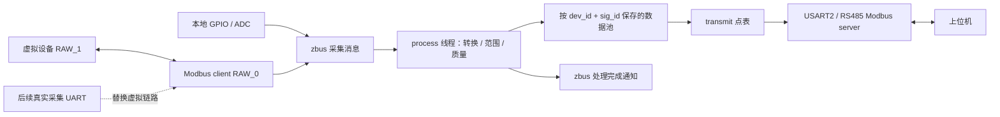

# IDU 点表：AIDC 接口分析与 Zephyr 实现

当前实现覆盖 **采集 → 处理 → 数据池 → Modbus 转发**，以及
**参数校验 → 下发与回读 → NVS 持久化 → 重启恢复**。目标是逐步替换
RT-Thread 平台中的这条数据链，当前没有完成整个 AIDC 固件或闭源平台库的替换。
所有运行时代码均在本仓库中，不链接参考项目的 `.lib`。

2026-10-14 已在前一轮对照基础上扩展用户指定的五项能力。最新实现、
构建入口和仍待确认的旧表问题见[本轮模块扩展](#module-extension)。
[旧模块逐项对照](#legacy-audit)保留为改动前的审计记录，不代表扩展后的状态。
2026-10-15 的旧硬件协议迁移状态见[MV-IO 兼容迁移](#mvio-migration)。

<a id="mvio-migration"></a>

## MV-IO 兼容迁移（2026-10-15）

依据 `io-interface-board/code/APP/Project` 当前启用的 `DEVICE_CONFIG_MV_IO`
分支迁移。`src/mvio.c` 使用 Zephyr Modbus 已解码的 ADU，配合点表/process、
NVS 和独立工作队列；不引入旧 FreeRTOS 串口解析任务。缺少的采集串口继续
使用虚拟后端，现有 USART2/RS485 负责转发。AIDC 可选配置不启用 MV-IO 策略。

| 项目 | 本次实现与约束 |
| --- | --- |
| 保存地址 | 线地址 30459、内部键 `1:30461`，FC03/06/16，写入 1–246；独立于拨码键 `1:30459` 和通信 unit。4814 内部别名也读保存地址 |
| 247 | 只接受起始地址 30459；FC03 可读、FC06/16 可写，FC04 因旧输入表无此项保持静默 |
| 保留写窗口 | FC06/16 起始地址 8149–8199、39278–39286、30459；除有效保存地址外只 ACK，不产生 DO、标定或 Flash 副作用。30459 越界值与旧代码一样 ACK 但忽略 |
| FC03 保留读 | 8149–8158、8178–8187、39278–39283 单字，39284 双字；返回零。读按旧表的顺序跨空洞推进，未知起始表项不应答 |
| 广播 | unit=0 只处理旧 FC04/FC16；普通旧读/写成功会应答。FC03/FC06 和扩展参数广播忽略；标准配置/AIDC 不采用这个规则 |
| 旧读窗口 | 起始地址 8149–8199、39278–39286、2503–2532、4989–5014、2568–2571，及 30459、2581、5486、20003、31996、31997；还必须匹配对应功能码的表项 |
| 长字段/门控 | 8150 可读取低字或完整协议号，8151 不能作为起点；2581 必须单独读 15 字。4805–4814 自动搜索的直接入口保持关闭，保留内部别名和旧表跨段顺序 |
| 错误响应 | 旧窗口非法请求、采集不可用及保存失败不应答；扩展参数保留标准异常码。完整长度/数量校验先于副作用，拒绝畸形报文，不复制旧越界访问 |
| 旧参数导入 | 从 0/0x1000 主备区只读导入保存地址，NVS 使用 0x10000 独立区；先主后备，不修写旧区 |
| 已有 NVS | 接受当前格式及唯一已知的加字段前格式；保存已有周期、标签、下游参数和提交序号，未知格式仍拒写 |
| 串口故障恢复 | 约 20 s 无有效请求触发当前配置重置，强制恢复不等待丢失的 TX 完成事件；工作回调卡住则报告超时，主循环停止喂狗 |
| IAP 能力 | 默认构建返回 0；`--mcuboot --iapv3` 初始化后返回 4、0x1200、0，开放 20049–20104 的旧入口，详见 [IAPv3 配置](../README.md#iapv3) |

扩展入口仅对本机 unit 开放：10000–10023、31000–31008、31500–31502、
31090–31093、32000–32003 和 30460；未定义点仍返回异常。保存成功后才 ACK
是对旧逻辑的明确改进：旧代码先发响应，再写主备 Flash；当前失败不会给成功
应答。含版本字符串的混合/不完整读拒绝，不复现旧表遍历中的缓冲区越界行为。
版本字符串仍标识 Zephyr 应用，采样时序/ADC 饱和策略也保留已说明的差异。

### 参数格式与掉电边界

旧 `G_FLASH_T` 的 ARM 布局为 8 字节：地址 byte0、padding byte1、
类型 LE16@2、协议 LE32@4；每个 4096 B 扇区的 LE16 长度在 4092，
Modbus CRC16 在 4094。已按旧源码布局和已知 CRC 测试向量验证解析。
设备类型/协议号仍由固件定义，不从旧数据覆盖，符合旧初始化纠正规则。
旧初始化允许保存地址 0，因此导入保留 0；新增写入仍限定 1–246。

主区 CRC 错误/空白才尝试备份；两区均无有效记录采用默认地址 1。
CRC 正确但长度未知、Flash I/O 失败时停止参数写入，不把未知数据当空白。
只在 NVS 初次创建或上一版缺此字段时读取旧区。整组快照提交成功后，
下次启动不重复导入。首次导入写入中断可重试，旧主备区始终保持原内容。

公共参数定义新增 `param_added` 和 `seed_missing`：前者只允许“其余参数
签名完全相同”的上一代格式，后者只负责缺失值加载。默认虚拟配置的上一版
NVS 签名为 `0xfa1be938`，测试使用冻结的 4 参数快照，升级为 5 参数快照。
存在旧待确认事务时先验证意图，继续仅回读恢复；既不重发下游写，也不把
候选值提前当已提交状态。诊断 32000 bit3 表示本次挂载进行了已知格式升级。

### 端口恢复与启动检查

`idu_modbus_reconfigure()` 的正常参数切换继续等待旧响应完成；
`idu_modbus_recover()` 用于端口故障。两者先停止新工作提交，工作回调
最多等待 2 s，超时即返回，不无限阻塞控制队列，也不中途取消 Flash 事务。
`idu_modbus_service()` 由主循环调用，持续忙超过 20 s 报错，PC13 喂狗
随主循环停止。恢复尝试次数/最近错误可通过 `idu_modbus_get_health()` 查询。
native_sim 测试覆盖 TX 状态注入、工作线程停滞、初始化失败及回退失败；
它不模拟 UART/DE 的物理时序，真实断线、丢中断和长期运行仍须上板验证。

`build.sh` 导出前自动检查 HEX/BIN 范围、向量和一致性，生成
`build/IDU-pre/idu_pre/zephyr/IDU-pre-boot-check.json`。原 BOOT 从
0x08004000 取 SP/复位向量，关闭 SysTick、清 NVIC、设置 CONTROL/MSP/VTOR
后跳转；镜像已通过静态检查，尚未经过实际旧 BOOT 启动验证。

新增独立的 [MCUboot 启动/标准 SMP 升级配置](../README.md#mcuboot)：
已实现签名构建、交换分区和试运行确认策略，尚未上板；此入口不兼容旧 SGZ。
原有旧 BOOT 应用构建仍保留；另有 [IAPv3 兼容配置](../README.md#iapv3)，
已将旧接收/补包、AES 和 SGZ 解包接到 MCUboot slot1。

已进一步核对 IAP 后续接口：旧 APP 的 IAP 线地址为 20049–20104；
外部配置在 0x200000，SGZ 在 0x201000（上限 0xF0000），解包 BIN 在
0x300000。按旧 Makefile 的 `-fno-short-enums` 编译，BOOT `IAPV3_INFO`
为 692 B，CRC 字段偏移 688；已做 ARM 编译断言。MCUboot 配置保留旧配置只读，
使用新的固定字节布局日志，不写旧 BOOT 命令。当前已经实现接收/补包、AES、
SGZ/QuickLZ 解包、CRC/向量/签名校验及试运行提交；实板和旧上位机完整流程仍待验证。
下文旧对照表保留原审计时点，MV-IO 单 ARM IAP 的最新状态以 README 为准；
AIDC 的多设备/对下 IAP 不在本次迁移范围。

### 本轮验证

`tests/run.sh` 包含核心 38 项、AIDC 3 项、MV-IO 15 项、启动检查器 4 项，
以及核心 3 阶段和 MV-IO 2 阶段的独立进程重启测试。MV-IO 包含主区损坏
回退、未知布局、旧 NVS/旧意图、110 个写入截断位置、保存失败无 ACK、
247、广播和畸形报文。普通运行跳过的 reboot probe 由独立阶段运行覆盖。
报文测试基于旧源码确认的行为，并非在模拟器中运行旧固件或实际 UART。

全量日志：`build/IDU-pre/tests/mvio-migration-full.log`。
默认固件 FLASH 81,156 B / RAM 76,176 B；AIDC 虚拟版 FLASH 167,548 B /
RAM 115,832 B。HEX、测试摘要和源码/参考文件指纹在 `build/hex/`。
本轮未进行烧录、实际 Flash 取样或真机测试。


<a id="module-extension"></a>

## 本轮模块扩展（2026-10-14）

本轮覆盖用户指定的 process、参数操作、采集、转发及原业务表迁入。
使用 Zephyr 的 zbus、线程、消息队列、互斥锁、工作队列、Modbus 和 NVS。
硬件默认仍是已经运行过旧固件的 MV-IO，现有 USART2 转发，缺少的一路
使用虚拟采集。AIDC 使用可选配置；没有把 DSP 模型偏移当成 Modbus 地址。

| 项目 | 已实现 | 主入口 |
| --- | --- | --- |
| process | READ/INIT/WRITE/SAMPLE/TIMER；旧值/候选值；输入集合；一次输入发出多个输出；来源端口/功能码/地址上下文 | `modules/idu_points/include/idu/process.h` |
| 参数操作 | NO_COLLECT、NO_DM、NO_STORE、DEFER 独立组合；异步请求复制与完成回调；1 s 延后保存；成功保存后重启 | `process.c`、`params.c` |
| 采集 | 每总线独立调度；优先级与等待时间；模式选择；初始化读与设定值同步；设备状态/事件；同从机地址跨总线隔离 | `include/idu/collect.h` |
| 转发 | 通用地址段回调；四种字序；Modbus ADU 透传与地址重映射；串口参数异步生效及失败恢复 | `include/idu/forward.h`、`modbus_adapter.h` |
| 点表 | 导入原 process/range/transmit 及 UPP 字段元数据；自动展开 8 台 DSP；保留原 ID/地址和问题诊断 | `tools/import_aidc.py`、`cfg/equip/aidc/generated/` |

### 业务调用与效果边界

业务回调通过 `idu_txn_get(ctx,key,false,...)` 读取本次候选值，`true` 读取
事务捕获的旧值；`idu_txn_contains()` 查询原始输入，`idu_txn_emit()` 追加或
替换输出。同一请求的输入在第一个回调前已准备好，派生输出不递归调用回调。
读取依赖的可用性时用 `idu_txn_get_state()`，不能把未初始化的数值当成有效值。

业务写入使用 `idu_process_execute()` 或 `idu_process_submit()`；读回调通过
`idu_process_read()` / 转发层触发。底层 `idu_params_set_values()` 仍是参数
存储接口，直接调用会绕过业务 handler。原纯转换 `process` / `prepare_write`
保留原约束：不阻塞、不做 I/O、不重入点表。事务 handler 使用 txn 接口。

| 期望效果 | 操作标志 |
| --- | --- |
| 仅入池，不下发、不保存 | `NO_COLLECT | NO_STORE` |
| 只下发，缓存和持久值保持原状 | `NO_DM` |
| 入池并下发，不保存参数值 | `NO_STORE` |
| 入池并保存，不下发 | `NO_COLLECT` |
| 入池/下发后延后保存 | `DEFER`，或点属性 `IDU_PARAM_DEFER_STORE` |

异步 API 接收成功不等于操作完成，应检查 completion 中的整体及逐输出结果。
请求被复制；完成回调中的结果指针只在回调期间有效。
多设备输出按设备及标志分组提交，**不保证跨设备原子回滚**；后组失败时
保留先组的成功结果，并报告未执行项。所有输出先做通用类型/范围/权限校验，
组内仍可能因 prepare_write、存储或下游返回而失败。

NO_STORE 的暂态值不会被其他参数保存时带入快照。远端 NO_STORE/NO_DM
仍会写事务日志用于掉电对账，但不会改写该参数的持久目标值。
`idu_process_save_reboot(100)` 可在成功完成后调用；延时至少 100 ms，
刷盘失败则不重启，通过参数状态查错。定时回调在业务线程执行，忙时重试；
它不是硬实时定时器。延后保存是 Zephyr 本实现明确规定的 1 s 防抖策略，
并非已证实旧闭源库也使用同一时限。

采集队列优先级 0..3，兼顾等待时间，不抢占正在进行的事务。普通同步
下发使用总线互斥锁，不进入优先级队列。模式为 POLL、INIT、UPDATE、IV、
FAULT、PASSTHROUGH、SLEEP；特殊模式只调度匹配模式的队列请求。
初始化执行后端回调、init_only 块、process INIT 和目标参数同步。
模式管理提供任务互斥/调度能力，IAP、IV 曲线和录波的业务协议仍需各自实现。

通用转发段可注册回调或 Modbus 目标设备/地址。跨段请求被拒绝，透传会恢复
上游地址和事务号。当前完成的是 Modbus ADU 透传，不含旧 UPP/CAN 隧道协议。
串口修改先完成旧配置下的响应，暂停新请求调度，等待 TX 完成后切换；失败时
尝试恢复旧配置。AIDC 串口 1 的原寄存器 41655/41657/41659 分别控制波特率、
校验、停止位，设备地址为 41654。其他未装配端口不假装生效。

### 原表导入与明确保留的问题

重新导入命令（仅开发时需要参考目录，固件构建不依赖它）：

```bash
python applications/IDU-pre/tools/import_aidc.py --source /path/to/AIDC_CODE/CODE
```

导入结果：172 个去重后的本地点、41 个 DSP 点 × 8 台设备，加 19 个缺失
定义的占位点，共 519 个原表配置项；另保留 33 个 MV-IO 基础点，合计 552。
包含 88 个参数点、332 个采集块（328 个虚拟 UPP 模型读 + 4 个原演示块）和
108 个转发段（107 个原表映射 + 10012 虚拟来源标志）。AIDC 配置的转发地址
以 AIDC 原表为准；MV-IO 默认寄存器表继续由默认配置提供。

`generated/migration.json` 记录输入源码 SHA-256、行号、原始 flags、回调名、
全部 445 条 UPP 字段定义及生成诊断。它记录的是可见源码元数据，不是闭源
库行为的证明。当前从具有 process 定义的信号中，每个选择一条模型绑定，
用于虚拟后端测试；其他模型字段完整保留在元数据中，没有虚构其实际运行语义。
虚拟 UPP 周期为显式配置的 1000 ms，原 `rqst_cyl` 编码只保留，未猜测换算。

- 6 条重复 process 定义内容相同，合并成唯一键并记录来源。
- 19 个本地转发信号（1001–1019）没有有效 process 定义。保留原映射及
  不可用占位点，初始读返回异常，不伪造正常采集值。
- 原 43001–43019 区域的相邻双寄存器点存在 17 对重叠。保留地址，采用
  “起址和长度必须恰好匹配一个完整点”的兼容策略，拒绝含歧义的跨点读。
  这是当前选择的规则，尚未由旧库运行结果确认。单寄存器 API 也拒绝歧义。
- 本地 2502 声明 U16、长度 4 字节；32058 声明 U32、长度 2 字节。
  这两项按原长度作为原始 words 保存，记录类型冲突，不静默改地址或长度。
- 已接入串口枚举校验、协议属性/版本读取、SN/名称同键别名。AES、网络、
  DSP 设备管理、IAP/录波等原业务回调涉及当前未实现的产品服务；相应命令
  返回不支持/无设备。纯存储配置仍可保存，但不代表已启用对应外设服务。

这些配置问题和未实现的产品服务意味着：**点表定义已经迁入，尚不能把整个
AIDC 产品业务或旧闭源库宣称为等价替换。** 原 MV-IO 保存地址、247、
参数导入已在[后续迁移](#mvio-migration)补齐；MV-IO 单 ARM IAP 已接入
[MCUboot](../README.md#iapv3)，真机启动与升级仍待验证。

### 构建、存储与验证

默认 MV-IO 构建与 HEX 导出：

```bash
./build.sh IDU-pre idu_pre
```

可选 AIDC 虚拟配置使用独立构建目录，保留默认 HEX：

```bash
west build -p auto -b idu_pre applications/IDU-pre \
  -d build/IDU-pre/aidc-virtual -- -DEXTRA_CONF_FILE=conf/aidc-virtual.conf
mkdir -p build/hex
cp build/IDU-pre/aidc-virtual/zephyr/IDU-pre.hex build/hex/IDU-pre-AIDC-virtual.hex
```

两者仍使用 GD32E505 / 20 MHz 有源时钟板级配置。默认 NVS 位于外部 Flash
0x10000–0x13fff；AIDC NVS 使用独立的 0x14000–0x17fff，避免两个配置互相
覆盖参数格式。旧主/备参数区和升级区保持原用途；默认 MV-IO 只读导入
已知旧参数格式，AIDC 不导入，未知格式不自动擦除。

运行全部主机检查：

```bash
./applications/IDU-pre/tests/run.sh
```

包含寄存器 ASan/UBSan 对比、Zephyr native_sim 核心测试、三个独立进程的
掉电恢复阶段和完整 AIDC 配置测试。覆盖新功能的协议收发、忙/失败路径和
Flash 故障注入。原 `legacy_registers.c` 是早期 Zephyr 重构对照，不是旧固件
可执行行为的完整 oracle。目标构建验证链接和容量；上板 RS485 电气时序、
真实设备参数同步、存储掉电及长期压力运行仍需用实际硬件验证。

2026-10-14 的模块扩展验证：38 项核心测试、3 项 AIDC 配置测试和 3 个独立掉电恢复阶段
通过；普通测试中的一个 reboot probe 跳过项已由后面三个阶段覆盖。
当前构建容量及 2026-10-15 新增回归见[MV-IO 迁移验证](#mvio-migration)。
板级容量 FLASH 496 KB / RAM 128 KB；未进行上板烧录。
最终文件为 `build/hex/IDU-pre.hex` 和 `build/hex/IDU-pre-AIDC-virtual.hex`；
测试摘要、源码指纹及 HEX SHA-256 记录在 `build/hex/IDU-pre-validation.json`。

详细 API 约束见 [公共模块说明](../modules/idu_points/README.md)。

## 参考依据与逆向分析的边界

分析目录：`/home/ryan/Documents/AIDC_CODE/CODE`。

| 参考文件 | 可确认的接口行为 | 本项目对应位置 |
| --- | --- | --- |
| `app/cfg/equip/dev_cfg.c` | 用设备 ID、端口、从机地址关联处理、采集、转发表 | `cfg/equip/dev_cfg.c` |
| `app/cfg/equip/table/collect.c`、`platform/inc/collect_lib.h` | 信号 ID、寄存器/模型偏移、数量、类型、周期、字序描述采集 | `cfg/equip/table/collect.c` |
| `app/cfg/equip/table/process.c`、`platform/inc/data_process.h` | `dev_id/sig_id` 区分信号，配置长度、类型、处理回调 | `cfg/equip/table/process.c` |
| `app/cfg/equip/range/signal_range.c` | 默认值和范围由配置管理 | 处理表中的 `initial/minimum/maximum` |
| `app/cfg/equip/table/transmit.c`、`platform/inc/transmit_lib.h` | 协议地址和内部信号分离；同一信号可以有多个转发地址 | `cfg/equip/table/transmit.c` |
| `app/process/app/APP_FUNC.C` 等 | 业务回调转换采集/协议值 | 处理表中的 `process` 回调；本地 ADC 电流转换已接入 |

当前参考项目的主采集表实际是 **DSP UPP**，不能把 UPP 的模型偏移当成
Modbus 寄存器。这里复用它的配置思想，采集口按用户要求使用 Modbus。
演示从机采用已确认的 MV-IO 寄存器，不代表已实现 DSP/UPP 协议。

本次还使用 GNU Arm `ar`、`nm` 和 `objdump` 只读检查了
`platform/libs/plateform.lib`。可以确认：

- 它是带符号的静态归档，含 `co_mgr.o`、`co_modbus.o`、`dp_mgr.o`、
  `dp_para_set.o`、`dp_para_store.o` 等对象。
- 有 `co_init`、`tr_init`、`dp_get_sig_value`、`dp_set_sig_value` 等导出函数。
- `dp_set_sig_value` 的反汇编显示：检查输入指针、调用 `dp_mutex_lock`、
  `dp_set_para_proc`、`dp_mutex_unlock`，并在条件满足时调用
  `dp_para_store_flush`。这说明写操作还包含处理和存储路径，不能把它
  等同于给某个数组赋值。
- 该归档 SHA-256 为
  `4762b9a9db877edb73cba48c078c80d379a262bf42e40ec2a96488bdc72cae43`。
  `sunshine_mini_c/platform/libs/plateform.lib` 是另一个版本，SHA-256 为
  `fc8a3c5ec49733aa6561b61ac0d209b8491f52eb824f231dc649bbdf5161cf1c`。
  后续分析必须先固定实际产品链接的库版本，不能混用二者的 ABI 假设。

上述证据不足以证明原库的回调先后顺序、持久化事务、重试规则、
动态设备生命周期和全部边界行为。当前实现采用明确的新接口契约，
不是原库的二进制兼容替换，也没有声称恢复了全部源码。

## 运行链路



用户已确认：**现有 USART2/RS485 转发，缺少的一路作为采集口**。
USART0 仍是日志控制台。

- 本地采集在主线程；Modbus 采集有独立线程，按块配置周期轮询。
- 所有业务转换在优先级 5 的 process 线程执行。采集线程优先级为 7。
- 北向转发使用优先级 6 的独立工作队列；南向接收仍用系统工作队列。
  参数写回调可以等待南向 Modbus，避免在系统工作队列内自锁。
  读请求只读取缓存；同一北向接口按请求串行处理，正在执行的参数
  写事务会占用该接口到成功或失败，不承诺写事务期间并行处理读请求。
- 处理线程使用 zbus **message subscriber** 接收消息副本，避免不同
  来源的采集批次被“只读最新频道值”的方式覆盖。
- 一个采集块在持锁期间整体更新；不同轮询块可以有不同采样时间。
  API 的寄存器读取按单寄存器提供，不承诺任意线程配置下整张点表的
  多寄存器事务快照。参数内部缓存提交受同一互斥锁保护。
- 默认最多排队 6 批，批次最多 12 点，每点最多 16 个 16 位字。
  采集频道使用独立固定缓冲池，发布 API 用信号量预留容量、互斥锁
  串行发布；队列满时按指定超时返回错误。没有动态分配采集消息。
- `idu_processed_chan` 是可合并的处理完成通知，可加普通 subscriber
  或快速 listener。不要给它添加保留消息副本的 message subscriber，
  也不要绕过 `idu_points_publish()` 直接发布内部采集频道。
- 主循环同时检查处理线程进展；本地发布失败或处理停滞会停止喂狗。
  下游掉线只改变远程测点质量，不使本地采集或上位机转发停止。

### 点值与质量

支持 `U16/S16/U32/S32` 和定长字数组。字符串用字数组表示，每个
寄存器的高字节在前；字符串字序与数值的高低字顺序是不同概念。
32 位数值在数据池内统一低字在前，采集和转发表可分别指定高字或低字在前。
Modbus 每个寄存器的线缆字节序由 Zephyr 协议栈处理。

常量使用配置默认值且立即有效。运行时采集点从 UNINITIALIZED 开始，
不能用默认的 0 冒充有效采样。数据质量低字节定义如下：

| 值 | 含义 |
| --- | --- |
| 0 | GOOD，有效 |
| 1 | UNINITIALIZED，尚未采集 |
| 2 | COMM_ERROR，本次采集失败 |
| 3 | STALE，已超过该点的 `stale_ms` |
| 4 | BAD_VALUE，转换失败或数值超范围 |

`0x0100` 是 **SIMULATED** 来源标记，与质量按位组合。例如虚拟点正常
是 `0x0100`，虚拟点通信失败是 `0x0102`。成功采集后恢复 GOOD。
失败时可在内部保留上次值用于诊断，但普通 Modbus 数据读取返回异常，
不会把旧值当成新值。`sampled_at/generation/error` 可经内部读取 API 获取。

Zephyr 4.4.2 的标准输入/保持寄存器读回调把应用读错误统一转换成
异常码 `02`。因此未知地址、无效值和过期值在线上都可能返回 `02`，
具体原因读取下面的质量寄存器。参数写入使用后述的整包适配。

## IDU-pre 配置和寄存器

本地设备 `dev_id=1`，远程 IO 设备 `dev_id=10`。二者可以有相同
`sig_id`，不会覆盖；远程从机地址在 `dev_cfg.c` 中配置，当前为 1。
上位机访问 IDU 的地址仍由板上拨码决定（1–16）。

原有 8149–8199 等本地寄存器和 SN/版本别名保留。电流换算从主循环
移入处理回调，原始 ADC 值大于 4095 时拒绝，转换后仍按 16 位饱和。
`tests/legacy_registers.c` 冻结的是本项目早期 Zephyr 映射，仅验证点表
重构前后的一致性；它没有执行旧 MV-IO 代码，不能证明与旧真机协议
等价，也不参与固件链接。运行时寄存器配置统一在三张点表中。

以下是新增的 **原始报文地址**，不减 1：

| 功能码 | 地址 | 内容 |
| --- | --- | --- |
| 04 | 10000 | 远程 DI 位图 |
| 04 | 10001–10008 | 远程八路电流，单位 0.01 A |
| 04 | 10009 | 远程 DI 的质量 |
| 04 | 10010–10011 | 远程协议号，低字在前 |
| 04 | 10012 | 采集后端：1 虚拟，0 真实 RTU |
| 04 | 10014–10021 | 八路远程电流各自的质量 |
| 04 | 10022 | 远程协议号的质量 |
| 04 | 10023 | 远程地址点的质量 |
| 03 | 30460 | 远程设备报告的通信地址 |

10013 没有定义；一次读请求跨过它会返回异常。03/30459 已恢复为本机
保存地址，读写并持久化；实际通信 unit 仍来自拨码。
这些新增地址是本项目的扩展，不是从 AIDC 旧协议推断出的兼容地址。

虚拟从机默认返回 DI=`0x0005`，八路电流为 `100,200,...,800`，协议号
`0x01000101`。这些是固定的测试数据，与板上真实 ADC 无关。
`idu_virtual_set_register()` 可修改测试值；`idu_virtual_set_online(false)`
让客户端真实等待超时。启动日志明确输出 VIRTUAL。

采集表分四块：DI、电流每 500 ms；协议号、远程地址每 5000 ms。
周期从上次完成开始计算；失败在下个周期重试，不做无间隔重试。
默认响应超时 100 ms，经接口转换为 Zephyr Modbus 所需的微秒。
修改 `CONFIG_IDU_COLLECT_TIMEOUT_MS` 时要同时评估总线负载和点的过期时间。

### 新增一个测点

1. 在 `dev_cfg.c` 中确认设备 ID 和从机地址。
2. 在 `table/process.c` 中增加 `{dev_id,sig_id}`、类型、字数、
   范围和过期时间。需要转换时添加 `.process`，回调必须快速且不做 I/O，
   不得递归调用点表 API；回调成功后才检查工程值范围。
3. 在 `table/collect.c` 选择合法的连续读块，把该点放入 `fields`。
   不应为了合包跨越设备没有定义的寄存器空洞。
4. 在 `table/transmit.c` 配置上位机功能码和地址；可给同一信号多个别名。
5. 运行测试。启动会拒绝重复信号、重叠转发地址、无设备的采集块、
   不匹配的宽度、重复采集所有者及越过 65535 的地址范围。

`IDU_WORDS` 的数值范围不检查；浮点、变长字符串、动态设备表和在线
修改点表尚未实现。三张表及设备表必须具有静态生命周期。

## 第二路串口补上后

1. 按实际原理图在板级设备树/overlay 配置第二路 UART、pinctrl、DE
   GPIO 及 `current-speed`。UART 下添加 `compatible = "zephyr,modbus-serial"`
   的子节点，用 `idu-collect` alias 指向这个子节点。
2. 现有 `idu-forward` alias 继续指向 USART2 的 `modbus0`。
   代码会检查两者不共用 UART，也不能占用日志控制台。
3. 按实际下挂设备修改采集点表、从机地址和串口格式。当前真实后端
   默认 8N1，波特率取采集 UART 的设备树配置。
4. 在工作区根目录构建：

```bash
./build.sh IDU-pre idu_pre -- \
  -DEXTRA_CONF_FILE=conf/collect-rtu.conf \
  -DDTC_OVERLAY_FILE=/absolute/path/to/actual-hardware.overlay
```

未补充 alias/硬件定义时真实后端会编译失败，不会自动抢用某个空闲串口。
切换回来应显式清理配置：

```bash
./build.sh IDU-pre idu_pre -p always
```

点表引擎、zbus 消息和上位机映射都不需要因为串口替换而重写。
若真实下挂设备不是 MV-IO，则应按其协议修改三张表。

## 验证和已知限制

工作区根目录执行：

```bash
./applications/IDU-pre/tests/run.sh
./build.sh IDU-pre idu_pre
```

测试脚本使用主机 GCC 运行原转换/寄存器回归测试（ASan/UBSan），再用
`native_sim/native/64` 运行实际 Zephyr 内核、zbus、Modbus client/server。
模拟器有两对 RAW 接口：一对模拟采集总线，一对模拟上位机访问转发服务。
用例覆盖本项目既有映射、双设备隔离、字序、有符号数、范围、超时恢复、
过期、非法批次、异常码、突发消息和队列耗尽后的恢复。

参数验证还覆盖：本机写入生效、业务侧按信号 ID 写入、纯准备回调拒绝、
只读权限、完整 FC16 校验、下游拒绝、丢失应答、离线后的恢复、禁止
自动重放、持久化失败前禁止下发、NVS 数据 CRC、未知格式拒写和恢复默认。
逐字节注入 160 个写失败位置，检查重挂载后不会出现新旧参数混合。
`run.sh` 另用独立 Flash 临时文件运行三个全新进程：写入并留下待恢复
事务、重启回读并提交、再次重启验证。模拟从机自身的 RAM 也随进程
重启，恢复阶段显式设置其已执行值，模拟独立供电的下游设备。

内存回环没有模拟 RTU CRC、波特率、帧间隔、DE 时序和真实设备延迟。
Flash 故障注入/进程重启也不能代替实机掉电测试。当前实机固件只有
现有转发口是 RTU，采集/下发仍为虚拟接口。

动态设备、原库延迟回调、UPP/CAN、增量上传和 IAP 尚未迁移；当前
接口不兼容旧平台库 ABI，也不把未知旧二进制行为当作已经还原。

## 参数下发与持久化

### 点表与 API

`IDU_SOURCE_PARAMETER` 与采集点分开，表示期望配置，而非实时反馈。
`param_flags` 支持 WRITE（可写）、PERSIST（保存）、RESTORE（可恢复
默认）、FORWARD（下发）。转发参数必须持久化，并指定从机设备、
`write_address`、`write_order`。`prepare_write` 只能校验/变换候选值，
不得 I/O、修改外部状态或递归调用点表 API。全部点校验通过后才产生
Flash 或总线操作；校验变换后的数值也再次检查范围。

- `idu_params_set_values()`：业务层按 `{dev_id,sig_id}` 批量设置，
  使用与 Modbus 相同的权限、校验和事务路径。
- `idu_params_write_registers()`：解析转发表的 FC03 映射，供北向 FC06/16 使用。
- `idu_params_restore(dev_id)`：只恢复标记 RESTORE 的点，经过同样的下发与保存路径。
- `idu_params_flush()`：同步保存当前配置。当前 PERSIST 参数每次写入已同步保存，
  没有后台延迟落盘窗口，也没有仿造旧库的全部 flags/ABI。
- `idu_params_recover()`：只回读待确认事务，绝不自动重发写命令。
- `idu_params_reload()`：在业务调用静止时重挂载并重读存储；不通过普通 Modbus 开放。

参数 API 是线程同步 API，不能从 ISR、系统工作队列或准备回调调用。
事务锁冲突返回 busy；不隐式排队或自动重试。完成后通过
`idu_param_events` 发布状态通知，使用普通 subscriber/快速 listener；
不要绑定保留消息副本的 message subscriber。通知可合并/丢弃，业务
以函数返回值和 `idu_params_get_status()` 为准；listener 不得重入参数 API。

上位机一次可写最多 32 个寄存器，参数点上限默认 16，每点最多 16 字。
32 位数/标签必须完整写入。请求可以包含多个本机参数，或者同一
下游设备上连续且完整的一组参数；禁止混合本机/下游、跨从机或跨
下游地址空洞，不通过拆分多笔写入来伪装跨设备原子事务。
转发参数只适用于**可回读的绝对设置值**，不能用于启动脉冲、清零、
计数加一等一次性命令。南向参数写入必须由本模块统一负责。

### 新增寄存器

下表地址均为报文原始地址，不减 1。FC16 即十进制 16 / 十六进制 0x10。

| 地址 | 读取/写入 | 内容 |
| --- | --- | --- |
| 31000 | FC03 / FC06 或 FC16 | 本机采样周期，100–1000 ms，默认 500；下一轮主循环采用新值 |
| 31001–31008 | FC03 / 完整 FC16 | 16 字节设备标签，默认 `IDU-pre`，每字高字节在前、尾部补 0；不改变旧 SN |
| 31500 | FC03 / FC06 或 FC16 | 虚拟设备设定值 0–1000，默认 100；下游 40000 |
| 31501–31502 | FC03 / 完整 FC16 | 虚拟 S32 偏移，−100000 至 100000，默认 0，低字在前；下游 40001–40002 |
| 31090 | FC06，写 0xA55A | 恢复本机默认参数并保存 |
| 31091 | FC06，写 0xA55A | 恢复虚拟下游默认参数，下发、回读并保存 |
| 31092 | FC06，写 1 | 同步保存当前参数 |
| 31093 | FC06，写 1 | 尝试回读恢复待确认事务 |
| 32000 | FC03，只读 | 状态位：bit0 存储可用，bit1 待确认事务，bit2 从历史记录恢复，bit3 已知格式升级 |
| 32001 | FC03，只读 | 最近完成的参数操作错误，S16，0 成功，负值为当前 Zephyr errno |
| 32002–32003 | FC03，只读 | 配置提交序号，U32，低字在前；重复同值写不增加 |

31500–31502/下游 40000–40002 是明确标注的**虚拟演示映射**，不来自
AIDC DSP 或真实 MV-IO 协议。切换真实采集后自动移除演示参数，31091
返回未知地址；真实可写点必须根据设备协议另行配置，禁止直接照搬。
参数上电只加载期望配置，不把它自动下发到设备，也不表示下游当前
状态已验证；需要实时反馈时另建采集点。

30459 为独立保存地址、30460 为只读远程地址。控制地址不能混在普通多参数事务内。
扩展参数广播写被忽略且不应答；旧 MV-IO 广播见兼容迁移一节。扩展地址的非法地址/只读写返回 02，范围/长度错误
返回 03，存储/确认失败返回 04，事务占用或有待恢复事务返回 06，
下游回读超时返回 0B；具体原因和状态可读 32000–32003。

例如：FC06 写 31000=750 → 成功应答后新周期已保存，重启仍为 750。
FC16 从 31500 连写 `[321, 0xFB2E, 0xFFFF]`，表示设定值 321、偏移 −1234。
下游确认并完成本机保存后才返回成功，值越界或只写半个 S32 都不修改任何点。

### 存储和故障处理

外部 W25Q32 的 `idu-settings` 位于 **0x10000–0x13FFF（16 KB）**，使用
4 个 4 KB 扇区。原 0/0x1000 两块参数和 0x200000/0x300000 升级区域
保留；默认配置已支持已知 8 B `G_FLASH_T` 的只读导入，不擦除旧参数。
实际 Flash 样本与掉电仍需上板验证。设备树的 `idu-settings`
alias 选择分区，NVS 只在该分区范围内工作。

使用 Zephyr NVS + `CONFIG_NVS_DATA_CRC=y`。每次把整组持久参数编码成
一个有版本、点表结构校验值和序号的记录（ID=1），避免逐个 key 保存
造成同一 FC16 的部分提交。不存裸 C 结构体，字段宽度/字节序固定。
NVS 相同数据不会重复写入；同值远程写仍需实际确认设备，可能产生
事务记录，因此上位机不应把参数写当成周期采集。

本机事务：整批校验 → 保存完整快照 → 一次提交内存缓存 → 应答。

下游事务：整批校验 → 读取下游旧值 → 保存意图记录（ID=2，含旧值、
新值及候选快照）→ FC06/16 → 回读 → 保存快照 → 更新缓存 → 删除意图
→ 应答。Flash 与下游无法物理地同时提交；意图记录用于识别并恢复
这个窗口，不宣称分布式原子提交。

- 回读与新值一致：确认成功，包括写应答丢失的情形。
- 与旧值一致且新旧不同：不提交候选，清除待确认状态，原写请求返回失败。
- 超时或既不是新值也不是旧值：保留意图，相关参数标为 COMM_ERROR，
  后续参数写/恢复默认/flush 返回 busy。采集仍运行，本机参数仍可读。
  修复链路后写 31093=1；重启也会尝试一次恢复。恢复只读，不自动重发。
  若设备值处于第三种状态，需核查并人工恢复设备到意图中的旧值或新值，
  再执行回读；旧/新值可由原请求和本机 NVS 意图记录核查，未提供远程强制清除。
- 本机保存或意图保存报错：保留原缓存并禁用写入，重启或在业务静止时
  重挂载以确定实际落盘结果。请求失败不代表设备绝对没执行，必须检查状态。
- 最新快照数据 CRC 损坏时最多检查 8 条历史记录；找到完整匹配记录则
  设置 bit2，告知配置可能回退。无有效记录、未知格式或结构变化时拒写，
  不自动格式化。首次空分区加载默认/已验证的导入值并保存一次完整快照，不周期性写 Flash。

设备表的参数键、类型、宽度、权限或下游映射变化可能使旧快照失配，
升级前需要明确迁移方案；本次仅允许 `param_added` 定义的精确上一代格式，
不静默抛弃其他未知参数配置。

### Zephyr Modbus 适配与升级

Zephyr 4.4.2 的 FC16 服务按寄存器调用回调，且接收工作默认放在系统
工作队列。因此 `modules/idu_points/compat` 在构建目录生成三份适配文件：
北向独立工作队列、FC06/16 整包写入入口，以及 RAW 单字节异常响应
长度修正，并增加按接口配置的 unit/广播策略。没有修改 west 管理的 Zephyr 源码。RAW 异常码现已真实到达
客户端，不再期望 `-EMSGSIZE`。

适配脚本锁定已检查的 4.4.2 源文件 SHA-256 和替换锚点。升级到 4.5
时仍需更新 manifest / west update，另外必须复核此适配层并重新运行
测试，不能直接把源文件哈希改成新值绕过检查。

## Zephyr 依据

- [zbus 官方说明](https://docs.zephyrproject.org/latest/services/zbus/index.html)
- [Message subscriber 示例](https://docs.zephyrproject.org/latest/samples/subsys/zbus/msg_subscriber/README.html)
- [NVS 官方说明](https://docs.zephyrproject.org/latest/services/storage/nvs/nvs.html)
- [Modbus API](https://docs.zephyrproject.org/latest/doxygen/html/group__modbus.html)
- 实际编译接口以工作区 v4.4.2 的 `include/zephyr/zbus/zbus.h`、
  `include/zephyr/modbus/modbus.h` 和对应子系统源码为准。

<a id="legacy-audit"></a>

## 旧模块逐项对照（2026-10-14，扩展前快照）

以下内容及 `legacy-audit-evidence.json` 是本轮实现之前的审计快照；
其中“缺少/尚未实现”是当时状态。新增能力请以上方[本轮模块扩展](#module-extension)为准。

**结论：现有代码实现了新点表引擎的基本链路及一套参数事务，尚未完整
替换旧 process / collect / transmit / 参数模块。** 本次只核对和记录
缺口，没有改动固件行为、参考工程或重新生成 HEX。

### 两套参考分别负责什么

| 基准 | 本次用途 | 已知状态 |
| --- | --- | --- |
| `/home/ryan/Documents/io-interface-board` 的 MV-IO 分支 | GD32E505 板级引脚、采集、RS485 协议、旧 Flash/BOOT/IAP 行为 | 用户确认已在实际硬件运行；旧固件用 FreeRTOS |
| `/home/ryan/Documents/AIDC_CODE/CODE` | equip 三张表、process 回调、参数/采集/转发模块的功能契约 | RT-Thread 平台；DSP 主链路为 CAN/UPP，与 MV-IO 的硬件和协议不同 |
| 当前 `IDU-pre` + `modules/idu_points` | 被对照实现 | Zephyr 4.4.2；现有口转发、虚拟口采集，按用户已确认的分工 |

旧硬件已验证这一事实作为迁移前提。仍需验证的是 Zephyr 新驱动、
调度、时钟初始化和协议实现的实际表现。不能把 AIDC 的全部 CAN、
网络或 DSP 功能当成 MV-IO 板上已经具备的功能。

本次核对了配置表、头文件契约、应用注册/调用路径、MV-IO 收包分发
路径，并检查 AIDC 链接产物提供的符号依据。没有运行闭源库或旧真机
对比测试。文中的“已有”只表示相应代码路径存在；“有差异”表示当前
契约明确不同；声明但未启用、仅二进制可见的内容另行注明。

### 实际启用范围和版本证据

- AIDC `aidc_local_config.h:10` 为 `AIDC_MINIMAL_FORWARD_MODE=1`、
  `AIDC_ENABLE_CAN_DSP_COLLECTION=1`。`app/main.c:122` 注册设备/范围表，
  `:168` 初始化 DP，随后初始化采集、转发和重定向。
- `dev_cfg.c:71` 默认设备配置包含 DSP1–8、本地设备、虚拟转发设备。
  DSP 用 CAN/UPP；UART6 上的 IO 和广播设备在 `#if 0` 内。
- `dev_cfg.c:45` 仍注册 IAP、自动搜索、故障录波透传、8 个 DSP 的
  UPP 透传地址段；`main.c:226` 初始化 UPP 透传，`:244` 初始化故障
  录波，`:268` 初始化上传线程和 IAP。它们并未全部被“最小模式”关闭。
- 定时业务注册、参数日志注册在 `!AIDC_MINIMAL_FORWARD_MODE` 内；
  初始化回调表注册、恢复完成回调注册被注释。增量表内容在 `#if 0`
  内且设备绑定被注释，UPP slave 表绑定也被注释。它们是旧框架可扩展
  能力，不能说是当前 AIDC 产品正在运行但 IDU 漏掉的全部功能。
- `product/APP_H745.uvprojx:1638` 指向根目录
  `platform/libs/plateform.lib`。找到 `product/build/keil/List/ARM_APP.map`
  和 `Obj/ARM_APP.axf`；map 中有 `plateform.lib(data_process.o)`、UPP
  透传及故障录波符号。应以这套 Keil 工程作为有产物支持的分析入口。
  根 Makefile 却引用未找到的 `platform/libs/release/libsunshinemini.a`，
  不能把它当作已复现的构建。
- map/AXF 的文件时间为 2026-09-29；它们支持接口归属分析，不证明
  当前目录所有源码与该产物完全一致，也不证明它就是现场烧录版本。
  两份不同的 `plateform.lib` 不能混用；`dev_cfg.c:19` 已有 UPP slave
  结构体 16 字节 ABI 适配，说明“相同头文件名”不足以证明 ABI 相同。
- MV-IO Git HEAD 为 `a595b3b2d2e68f35051cac8672ff4f382d18401e`，工作区
  已有修改，包括 `MainTask.c`。本次依据磁盘实际文件，未将修改回退。

[证据快照](legacy-audit-evidence.json) 保存相关源码、库、map、AXF 和
当前实现的 SHA-256，以及旧工程工作区状态，便于以后区分版本变化。
该文件是此次核对快照，不会随修改自动更新。

### 点表条目核对

[原始点表清单 CSV](legacy-point-inventory.csv) 包含 820 条配置记录及
来源行号、信号标识、类型、长度、flags、回调、协议地址等字段。
统计去除了注释；这四个文件的数组内未发现条件编译分支。CSV 保留
宏名称，没有展开宏或去重，条目数不能当作唯一信号数或完成百分比。

| AIDC 配置 | 条目数 | 对当前实现的影响 |
| --- | ---: | --- |
| `g_arm_data_table` | 178 | 本地串口、设备属性、网络、重定向等业务未按原表迁入 |
| `g_dsp_data_table` | 41 | 供 8 个 DSP 设备复用，当前虚拟 MV-IO 点不等于这些 DSP 点 |
| UPP 模型 1 / 2 / 99 / 100 / 102 / 103 | 1 / 5 / 46 / 100 / 36 / 257 | 合计 445，不能直接当成 Modbus 地址转换 |
| `g_arm_transmit_table_t` | 107 | AIDC 原转发映射尚未迁入；当前扩展寄存器是 IDU 自定义 |
| 本地 / DSP 范围表 | 12 / 37 | 需逐项迁移默认值、范围、恢复条件 |

还发现以下导入障碍，不能直接复制表后宣布兼容：

- 本地表重复出现 `LOCAL_SIG_DSP_ON_LINE_NUM`（3 次）、
  `LOCAL_SIG_VERSION`（2 次）、`LOCAL_SIG_5378`（3 次）、
  `LOCAL_SIG_5487`（2 次）。当前引擎拒绝重复键。需确认旧库的查找/
  覆盖规则和业务意图；CSV 暂保留每条记录，未替旧项目擅自去重。
- 本地有 64 字节 `LOCAL_SIG_NTP_SERVER` 和 1 字节 U8 点。
  旧头文件 `MPP_SIG_SIZE_MAX=144`；当前每点最多 32 字节且宽度以
  16 位寄存器计，不能原样表示这些配置。
- 按默认设备展开为 `178 + 8 × 41 = 506` 条处理配置，包含上述重复。
  当前 `CONFIG_IDU_POINTS_MAX_POINTS` 默认 64、允许上限 256；参数点
  默认 16、上限 32。完整迁表需要重新核算容量、内存和队列吞吐。
- UPP 采集表有 445 条，DSP process 表只有 41 条；不能假定每个模型
  字段都已有数据池信号。透传与入池覆盖关系需要按信号及模型分别验证。

### process / 数据池 / 参数语义

以下旧接口见 `platform/inc/data_process.h`，配置例子见
`app/cfg/equip/table/process.c`。当前入口是
`modules/idu_points/include/idu/points.h`、`params.h` 及对应实现。

| 项目 | 旧方案及证据 | 当前 Zephyr 状态 / 缺口 |
| --- | --- | --- |
| 信号身份 | `DEV_TABLE_S` + `dev_id/sig_id`，同一信号可映射多个协议地址 | 已有键和别名；未实现旧协议表类型/设备编码模型，设备 ID 分配也不同 |
| 值类型 | `arc_public.h:157` 定义 8/16/32/64 位整数、float/double、bool、字符串、时间及数组等 | 仅 U16/S16/U32/S32/定长字数组；字数组不等同于完整字符串/时间类型语义 |
| 读写初始化上下文 | `FUNC_PARA_ALL`，`:142`，type=写/读/初始化，携带源端口和本次全部参数 | 缺。当前回调只看到单点配置、新值、旧值；读缓存不触发业务回调 |
| 协议附加地址 | `FUNC_PARA_RD`，`:125`，Modbus 地址或 UPP 模型/偏移 | 缺统一请求上下文，无法直接移植依赖协议地址的回调 |
| 关联值读取 | `dp_get_para_value` / `dp_get_para_old_value` / `dp_check_para_set`，`:638` 起 | 缺当前事务候选值视图和“本次是否设置此点”的查询；当前锁内回调禁止调用点表 API |
| 多输出与跨设备联动 | `DM_PF_SIG_PROC` 的 `inpara/outpara`；`dp_set_para_value(_flag)`，`:668` 起 | 缺。当前纯转换不能从一个输入生成多个关联点或跨设备输出 |
| 输出缓存语义 | 头文件说明相同键替换、缓存满触发处理、派生输出不再触发回调 | 缺。zbus 批次队列不是这种回调输出缓存，不能直接视为等价 |
| 存储/下发 flags | `FLAG_PERSISTENCE/COLLECT/RT_STORE/READ_CALLBACK/PERSISTENCE_SYNC`，`:216` 起 | 有差异。新 WRITE/PERSIST/RESTORE/FORWARD 位值和含义不同，禁止直接复制数值 |
| 逐次操作 flags | `PARA_NO_SET_CO/NO_SET_DM/NO_STORE_DM`，`:258`；`:684` 起多种设置 API | 缺“只下发”“只入 DM”“只入 DM 不保存”“本次不下发”等独立操作语义 |
| 同步/延后保存 | `RT_STORE`、`PERSISTENCE_SYNC` 和 `dp_flush_para_store` | 有差异。当前所有 PERSIST 参数同步保存，无旧延时存储队列；相同数据去重不等于延后合并写 |
| 异步结果闭环 | `PARA_SET_FUNC`、`PARA_SET_STATUS`、`dp_fast_para_set`、`dp_para_reg_set_func`，`:405` / `:592` / `:625` | 缺请求级异步完成回调、旧新值登记和结果关联；当前同步函数返回 + 可合并状态通知 |
| 参数业务 API | `dp_set_sig_value`、`dp_fast_para_get/set` | 已有按键读写及 Modbus 写入入口；返回码、无效值表达、同步时机均未按旧契约适配 |
| 多点事务范围 | 旧输入/输出支持多个设备和端口；具体部分失败规则仍需核实库行为 | 当前只允许本地一批或同一从机连续一批；拒绝混合、空洞、跨从机，不能替代旧业务联动 |
| 命令型测点 | 旧回调可执行开关、复位、清除、升级等动作，结果不一定能读回为原写值 | 当前下发仅接受可回读的绝对设置值；脉冲/动作命令缺独立执行及完成语义 |
| 初始化和一次/周期回调 | `dp_set_init`、`INIT_DATA_SET_S`、`TIME_DATA_SET_S`，`:378` / `:386` / `:807` | 缺注册与调度。当前 AIDC 的全局 init/timer 注册被关闭；框架完整替换仍需支持 |
| 动态设备生命周期 | `dp_dev_add/del`、`dp_reg_devchg_callback`、按端口/协议取设备表 | 缺。当前表为静态单例，只有一种采集总线配置；不能热插拔或替换设备表 |
| 动态信号回调和设备数据复位 | `dp_reg_sig_callback`、`dp_dm_reset_dev_data`、`dp_updata_meter_coller_set` | 缺运行时注册、逐设备重置和电表采集配置更新 |
| 下游初始化同步 | `collect_lib.h:184` 的 `co_dev_init` 声明发送非轮询查询及全部设置报文 | 有差异。当前恢复 NVS 后不自动重发下游参数；仅回读未决事务，两条路径须分别设计 |
| 默认值及范围 | `signal_range_get`；`dp_get/set_para_def_range`；平台范围检查钩子 | 已有静态范围、默认值、纯校验；缺动态范围和原钩子。旧未找到范围时返回全零，库如何解释待确认 |
| 恢复默认/出厂 | `dp_load_def_data`、`dp_reset_factory`、恢复过滤/完成钩子；应用 `signal_range_restore_default` | 有部分功能。当前只恢复指定设备的 RESTORE 点；没有整机流程。旧应用按 `is_recover > 1` 逐点恢复，与当前批次语义不同 |
| 存储格式迁移 | `DM_SIG_CFG_DATA_S` 与 `pltcb_reg_para_size_mismatch_cb` | 缺。当前 schema 不匹配拒写；没有字段长度变化、旧文件到新格式的迁移 |
| 写参数审计 | `PARA_WRITE_LOG` 含时间、端口、设备、信号、协议地址、旧新值；`platform_callback.h:72` | 缺。当前状态频道不等于参数日志；该日志注册在当前 AIDC 最小模式中关闭 |
| 保存后重启 | `dp_set_reboot` / `dp_reboot_system` 约定刷写和延后复位 | 缺业务重启事务与原因记录；看门狗故障复位不能代替 |

当前 NVS 完整快照、写前持久化意图、丢失应答后回读、未知格式拒写是
已经实现的新行为，但旧库的掉电窗口、应答/保存顺序及回滚规则尚未
通过行为实验确认。不能因新方案更明确，就将其标注为“旧行为已还原”。

### collect / transmit / 业务模块

| 项目 | 旧方案及证据 | 当前 Zephyr 状态 / 缺口 |
| --- | --- | --- |
| 基础轮询 | `collect_lib.h:64`：信号、功能码、地址、长度、周期 | 已有显式连续 FC03/04 块；旧 `rqst_cyl` 编码未核实，不能直接等同于毫秒 |
| 合包/拆包及请求能力 | 段帧标志、FC06/10 能力位、FC17 读写标志 | 缺点表驱动的打包策略和每点写能力约束；当前自动按数量选 FC06/16，未封装 FC17 |
| 排队和优先级 | 写入 0–3 级优先级、轮询高低优先级、设置队列清理 | 缺。当前单采集线程轮询，参数互斥冲突返回 busy，无旧优先级/队列语义 |
| 端口模式 | IDLE/INIT/UPDATE/IV/FAULT/TRAN；`co_set/get_port_mode` | 缺采集、升级、录波、透传之间的端口调度和模式切换 |
| 轮询控制/初始化 | `co_set_scan_pkg_flag`、`co_init_func_reg`、`co_dev_init` | 缺按报文启停、设备初始化状态机和重连同步策略 |
| 设备状态/绑定 | UNKNOWN/OFFLINE/ONLINE/EXCEPTION、绑定状态查询/设置 | 只有逐点质量；缺设备级状态、事件、绑定和原状态码映射 |
| 一条/多条总线 | 设备的 `port/coll_addr/dev_code`，按端口查询 | 当前单采集 iface、多从机；缺多总线隔离、独立超时/配置和任务调度 |
| 透传及回包入池 | `co_put_passthough_queue`、`co_anlysis_mb_pkg`、设置值转换回调 | 缺原始 RTU/TCP 透传队列、业务回包解析/入池及原转换钩子 |
| CAN/UPP 主采集 | 当前 AIDC 8 个 DSP、6 个模型表 | 未实现。虚拟 Modbus 验证不能算 UPP 替换；当前 MV-IO 硬件基线不因此新增 CAN 硬件需求 |
| 基础转发 | `transmit_lib.h:66`：设备、信号、FC03/04、寄存器、字序 | 已有缓存映射/别名；原 107 条业务映射未迁入 |
| 四类字节/字顺序 | `arc_byte_order.h:60`：BIG、SMALL、BIGSMALL、SMALLBIG，另有默认值 | 当前支持两种 32 位字顺序；缺字内交换及旧默认值规则 |
| 地址段回调 | `MB_TABLE_SEG_T` 整包交给业务；`dev_cfg.c:45` 的实际绑定 | 缺通用段路由。当前 31090–31093 固定控制寄存器不能替代 IAP/搜索/录波段回调 |
| 请求/应答语义 | 读回调可生成动态值、源端口参与处理；异常/无效值由旧栈决定 | 当前缓存读，过期/错误点映射为异常 02；缺旧行为对比和完整请求读取一致性契约 |
| 北向模式与过滤 | SLAVE/SLEEP/CALLBACK、过滤器、端口工作控制、连接检测、计数 | 缺统一接口；当前单 RS485 server 和拨码重建接口只覆盖基本通信 |
| 加密/动态串口参数 | `tr_aes_pkt_send`、`local_tr_aes_key_config`、`local_equip_take_sig_effect` | 缺。原表中 43 条串口相关回调绑定仍存在，当前仅采样周期等少量参数有应用效果 |
| 重定向 | `redirect_sig_callback` 及源/目标端口、保持时长 | 未迁移，不能用 zbus 数据广播替代原始端口重定向 |
| 增量上传/相关点组 | `transmit_lib.h` 的变化幅度、读回调、关联信号组 | 未实现；当前 AIDC 的增量表和绑定关闭，作为框架后续能力记录 |
| 故障录波/上传 | AIDC `faultrecord_init`、录波地址段、YMODEM 上传线程 | 未迁移，且当前 AIDC 最小模式仍初始化这些功能 |
| 升级 | AIDC IAPv3、MV-IO IAPv3/外部镜像与旧 BOOT 各有实现 | 未迁移。仅保留 Flash 分区和应用起始地址不等于升级已兼容 |
| 平台/业务配套 | 原设备属性、SN、版本、网络参数、时间、日志及 OS/文件接口 | 仅少量常量和 Zephyr 基础线程/锁/定时器/NVS；旧业务回调和平台服务未系统迁移 |

### MV-IO 真机基线对照

下表的旧路径均相对 `io-interface-board/code/APP/Project/`。
特别区分“表中定义”和“当前收包分发能到达”，避免凭注释推断线上能力。

| 项目 | 旧代码依据 | 当前状态 / 缺口 |
| --- | --- | --- |
| DI16、拨码、LED、RS485、SPI 引脚 | `Peripheral/Gpio.c`、`Drivers/Sci.c`、`APP/MainTask.c` | 已按代码映射；硬件由用户确认已运行，Zephyr 移植仍需实际比对 |
| MCU/时钟/启动 | 用户确认 E505、20 MHz 有源输入；旧启动/链接文件 | 当前新增 E505 SoC、bypass/PLL、应用偏移 0x4000；未验证新镜像经过旧 BOOT 的启动流程。旧文件中的 CL/时钟路径不能覆盖用户实物信息 |
| ADC 通道与平均 | `Drivers/Adc.c` 连续 ADC+DMA；`AdcDriver.c:98` 取 10 组平均 | 通道/平均次数相同，但当前为逐通道轮询；采样时刻、同步性、延迟不同 |
| 电流换算 | `Peripheral/include/AdcDriver.h` 的浮点宏 | 主公式沿用；旧宏直接转 U16、未钳位上限，当前整数运算并饱和。舍入及超量程行为未等价验证，不能假定旧越界转换固定回绕 |
| 采样失败及质量 | 旧 DI/ADC 直接读全局缓存，无当前的过期质量契约 | 当前初始无效/超时/过期报异常；主循环或处理停滞停止喂狗，这是新增行为 |
| 喂狗和启动等待 | `Peripheral/wDog.c:23` 独立任务持续喂狗；`MainTask.c:411` 等待后加载参数/启动通信 | 当前健康门控定时喂狗、初始化顺序不同；需在旧硬件上验新启动窗口和故障策略 |
| 串口故障恢复 | `Protocol/Modbus.c:80` 发送状态持续超时后重新初始化串口 | 当前未实现对应故障恢复/独立转发线程健康监测；Zephyr 驱动自身行为需另查验证 |
| 基础 FC04 数据 | `Protocol/ModbusCallBackFun.c:21`，8149 类型、8150 协议、8152 DI、8163–8170 电流 | 核心映射已有，版本为 IDU 自身版本；跨表项读取、字符串长度、异常和时序未逐帧复核 |
| **30459 保存地址** | `ModbusCallBackFun.c:184`、`:968`、`:974`，范围 1–246；`Modbus.c:420` 保存 | **明确差异：当前只读拨码值。需补保存地址点、旧 FC06/16 映射、范围和持久化，并保留收包地址取拨码的旧逻辑** |
| 收包地址和匿名地址 | `MainTask.c:18` 取实时拨码；`Modbus.c:111` 接收本机/0/247，`:159` 限 247 请求起始地址为 30459 | 当前支持拨码 unit；缺 247 特殊入口，不能简单把保存地址写入后切换 unit 当成兼容修复 |
| FC03 保留地址及空操作写 | `ModbusCallBackFun.c:155`，8149–8158、8178–8187、39278 起部分表项；`:718` 空操作返回成功 | 当前大多未映射、返回异常。需按表项类型/范围及分发可达性核对，不能把 FC04 的零值映射当作 FC03/写入兼容 |
| 搜索、4814、4885 | 表中 4814 读保存地址，4885 有 ACK_DELAY 读写；`Modbus.c:266` 附近搜索段入口和随机延时被注释 | 当前 Zephyr 新增可直接读的 4805–4814 别名且 4814 为拨码值；旧直接搜索/ACK 配置不能仅凭表项认定已启用，不应列为“旧已运行搜索功能漏迁” |
| 广播和失败应答 | `Modbus.c` 接收 FC04/10 广播；不同分支有不同应答条件，普通失败路径常不发包 | 当前标准 Modbus 行为不可默认等价；需测试普通广播写、IAP 广播、非法地址、范围错误、CRC 错误和静默/异常应答 |
| 参数保存与 ACK 顺序 | 旧先调用发送接口，再在收包处理末尾检查 `needwriteflash` 保存 | 当前新参数保存完成后应答；两者顺序和延迟不同。旧的发送调用不证明最后一位已发完，需抓包测量 |
| 旧参数导入 | `APP/include/mvsfunction.h:36` 的地址/U16 类型/U32 协议号；`MainTask.c:174` 主/备长度+CRC16 校验、备份修复 | 当前独立 NVS 未导入这些字段。结构定义已找到，仍需固定旧编译布局和有效 Flash 样本；不能再笼统称字段完全未知 |
| 升级能力与 IAP 地址 | 20003、31996/31997；`Modbus.c` 路由 IAP，`FreeRTOS/src/OS.c:101` 初始化 IAP | 当前缺能力寄存器及实际升级。旧 MV-IO IAP 分发为 `20049–20104`，AIDC 段从 `20050` 起，两者不可混用 |
| DO/扩展 DI/NTC | MV-IO 的 DO 初始化/控制和扩展读取未启用；部分引脚与有效 DI/ADC 重合 | 不作为当前硬件必补功能。需保持实际分支，不能照 EMU 或功能介绍表启用冲突引脚 |

关于 `4814` 的精确结论是：**旧表回调读取保存值，但当前分发禁止以该
搜索段直接进入**。旧读取代码还会沿表顺序向后取项，存在跨段/非标准
长度请求的边界问题；不能简单推断所有方式都不可达。这些边界应成为
对照用例，不直接照搬潜在的越界访问或未定义行为。

### 按旧方案推进的顺序与验收条件

1. **冻结兼容基准和协议用例。** 以本次文件哈希、实际开关和 CSV 为
   起点；从旧可见源码建立 MV-IO 逐帧预期，覆盖 30459、247、保持寄存器、
   广播、字符串、越界/失败应答。保存旧真机输入/输出及重启后的参数样本。
   对闭源行为固定同一库/固件版本，区分头文件约定、反汇编证据与实测。
2. **先补 process 契约。** 请求上下文 → 候选值/旧值视图 → 多点输出 →
   每次操作 flags → 读/写/初始化回调 → 一次/周期调度。用一个输入联动
   两个输出、只入池不存储、只下发不入池、读时生成值等场景验收。
   执行和等待应放在 Zephyr 线程/工作队列中；zbus 传事件，保留旧模块职责。
3. **补参数与采集闭环。** 异步请求结果、保存策略、命令点与绝对设定值
   分流、恢复默认/保存后重启、旧参数导入，以及优先级、端口模式、设备
   初始化/重连同步。验收应明确失败属于哪一个设备/阶段；不能把跨设备
   联动擅自承诺为物理原子事务。
4. **补转发路由与原业务表。** 地址段、原字序、串口参数生效、动态设备
   和容量；逐点核对 CSV，解决重复键与未入池模型字段。AIDC 的 CAN/UPP、
   录波/上传、IAP 作为独立模块迁移；缺少真实采集串口时继续用虚拟后端
   测模块契约，避免将虚拟通过误认为物理链路通过。
5. **在已验证硬件上验收 Zephyr 替换。** 相同 DI/模拟输入、新旧寄存器
   逐帧比对、拨码改变、DE 收发切换、长时间轮询/写入、拔线重连、主/备
   参数导入与掉电、旧 BOOT 启动/IAP。以后补上第二串口后再验证真实下发。

验收分三层记录：当前引擎自身测试、与旧源码/库的契约对照测试、同板
实机输入输出对照。现有 ASan/UBSan、native_sim、NVS 故障注入及重启
测试属于第一层；`tests/legacy_registers.c` 也是早期 Zephyr 的重构
回归依据。本次没有把它们计作后两层已经通过，也没有重新运行固件测试。

### 主要源码入口

- [AIDC 设备绑定和地址段](/home/ryan/Documents/AIDC_CODE/CODE/app/cfg/equip/dev_cfg.c:45)、[实际启动注册](/home/ryan/Documents/AIDC_CODE/CODE/app/main.c:122)、[启用开关](/home/ryan/Documents/AIDC_CODE/CODE/app/cfg/inc/aidc_local_config.h:10)。
- [DP 上下文及接口](/home/ryan/Documents/AIDC_CODE/CODE/platform/inc/data_process.h:133)、[采集接口](/home/ryan/Documents/AIDC_CODE/CODE/platform/inc/collect_lib.h:64)、[转发接口](/home/ryan/Documents/AIDC_CODE/CODE/platform/inc/transmit_lib.h:66)、[平台回调](/home/ryan/Documents/AIDC_CODE/CODE/platform/inc/platform_callback.h:37)。
- [AIDC 处理表](/home/ryan/Documents/AIDC_CODE/CODE/app/cfg/equip/table/process.c:16)、[范围与恢复默认](/home/ryan/Documents/AIDC_CODE/CODE/app/cfg/equip/range/signal_range.c:209)、[Keil 工程](/home/ryan/Documents/AIDC_CODE/CODE/product/APP_H745.uvprojx:1638)。
- [MV-IO 真实收包分发](/home/ryan/Documents/io-interface-board/code/APP/Project/Protocol/Modbus.c:111)、[保持寄存器表](/home/ryan/Documents/io-interface-board/code/APP/Project/Protocol/ModbusCallBackFun.c:155)、[保存地址读写](/home/ryan/Documents/io-interface-board/code/APP/Project/Protocol/ModbusCallBackFun.c:968)、[旧参数恢复](/home/ryan/Documents/io-interface-board/code/APP/Project/APP/MainTask.c:174)。
- [当前点表契约](../modules/idu_points/include/idu/points.h)、[当前参数契约](../modules/idu_points/include/idu/params.h)、[当前引擎容量](../modules/idu_points/Kconfig)。
