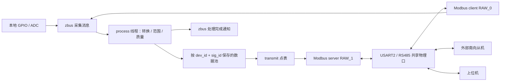

# 点表、寄存器与参数事务

[文档导航](README.md) · [架构设计](collect-process-transmit.md) · [点表维护指南](../app/protocol/README.md)

本页描述 IDU 的点值/质量、北向寄存器、参数持久化及采集后端配置。
文件职责和新增点步骤集中在[点表维护指南](../app/protocol/README.md)，
原平台接口覆盖集中在[参考平台对照](reference-platform.md)。
普通转发使用连续地址点表；IAPv3 通过设备挂载的 `PRO_ADDR_SLAVE` 协议段接入。
段表见 [`segments.c`](../app/protocol/tables/segments.c)：按请求首地址匹配，
IAP 回调校验完整 ADU 和变长载荷，不套用普通寄存器段的整段范围限制。
历史迁移和旧库分析见[迁移记录](migration-history.md)。

## 运行链路

用户已确认：**北向转发与南向周期采集共用现有 USART2/RS485 做性能联调**。
USART0 仍是日志控制台。

- 本地采集在主线程；Modbus 采集每总线使用独立线程，按块配置周期轮询。
- 采样消息由处理线程消费；同步业务 API 在调用线程执行，异步请求和
  TIMER 回调由独立业务线程执行。回调应遵守各自的锁和重入约束。
- 北向转发使用优先级 6 的独立工作队列；南向接收仍用系统工作队列。
  参数写回调可以等待南向 Modbus，避免在系统工作队列内自锁。
  普通读读取缓存；声明 `read_callback` 的点通过 process 读回调生成值。
  同一北向接口按请求串行处理，正在执行的参数
  写事务会占用该接口到成功或失败，不承诺写事务期间并行处理读请求。
- 处理线程使用 zbus **message subscriber** 接收消息副本，避免不同
  来源的采集批次被“只读最新频道值”的方式覆盖。
- 一个采集块在持锁期间整体更新；不同轮询块可以有不同采样时间。
  `tr_read_register()` 提供单寄存器映射读取，`tr_read()` 提供带来源端口的
  多寄存器读取；二者均在 `transmit/transmit.h`，不属于 dataprocess。
  按信号键读取使用 `dp_read()`。不承诺任意线程配置下整张点表的多寄存器
  事务快照；参数内部缓存提交受同一互斥锁保护。
- 默认最多排队 6 批，批次最多 12 点，每点最多 16 个 16 位字。
  采集频道使用独立固定缓冲池，发布 API 用信号量预留容量、互斥锁
  串行发布；队列满时按指定超时返回错误。没有动态分配采集消息。
- `dp_processed_chan` 是可合并的处理完成通知，可加普通 subscriber
  或快速 listener。不要给它添加保留消息副本的 message subscriber，
  也不要绕过 `dp_publish()` 直接发布内部采集频道。
- 主循环同时检查处理线程进展；本地发布失败或处理停滞会停止喂狗。
  下游掉线只改变远程测点质量，不使本地采集或上位机转发停止。

### 点值与质量

支持 `U8/U16/S16/U32/S32` 和定长字数组。字符串用字数组表示，每个
寄存器的高字节在前；字符串字序与数值的高低字顺序是不同概念。
32 位数值在数据池内统一低字在前，采集和转发表可分别指定高字或低字在前。
Modbus 每个寄存器的线缆字节序由 Zephyr 协议栈处理。

IDU 固定标识通过 INIT 回调发布默认值；原生引擎的 CONSTANT 点可直接有效。运行时采集点从 UNINITIALIZED 开始，
不能用默认的 0 冒充有效采样。数据质量低字节定义如下：

| 值 | 含义 |
| --- | --- |
| 0 | GOOD，有效 |
| 1 | UNINITIALIZED，尚未采集 |
| 2 | COMM_ERROR，本次采集失败 |
| 3 | STALE，已超过该点的 `stale_ms` |
| 4 | BAD_VALUE，转换失败或数值超范围 |

`0x0100` 是 **SIMULATED** 来源标记，与质量按位组合。例如虚拟点正常
是 `0x0100`，虚拟点通信失败是 `0x0102`。成功采集后恢复 GOOD。
失败时可在内部保留上次值用于诊断，但普通 Modbus 数据读取返回异常，
不会把旧值当成新值。`sampled_at/generation/error` 可经内部读取 API 获取。

Zephyr 4.4.2 的标准输入/保持寄存器读回调把应用读错误统一转换成
异常码 `02`。因此未知地址、无效值和过期值在线上都可能返回 `02`，
当前产品未映射质量寄存器，可用内部 `dp_read()` 查询质量和错误；采样年龄过期也暂未启用。参数写入使用后述的整包适配。

## IDU-pre 配置和寄存器

本地设备 `dev_id=1`，远程 IO 设备 `dev_id=10`。二者可以有相同
`sig_id`，不会覆盖；远程从机地址在 `app/protocol/protocol.c` 的设备条目中配置，当前为 1。
上位机访问 IDU 的地址仍由板上拨码决定（1–16）。

有效测点保留已有地址，删除旧窗口门控、跨空洞跳读、补零保留区及重复别名。
未映射地址返回 Modbus 异常；无效参数写不再成功应答。普通请求仅接受拨码地址，
没有 247 特殊入口；普通参数广播忽略且不应答。IAP 广播由升级模块单独处理。
电流换算使用 0.01 A，原始 ADC 超过 4095 时拒绝，转换后按 16 位饱和。

以下均为报文原始地址，不减 1：

| 功能码 | 地址 | 内容 |
| --- | --- | --- |
| 04 | 8149 | 设备类型 0x2221 |
| 04 | 8150–8151 | 协议号 0x01000101，低字在前 |
| 04 | 8152 | 本地 DI 位图 |
| 04 | 8163–8170 | 本地八路电流，0.01 A |
| 04 | 2503、2568–2571、5486 | 点表中的协议标识字段 |
| 04 | 2504–2513 | SN 默认值 `SG-FACTORY`，尚非唯一出厂 SN |
| 04 | 2581–2595 | 应用版本字符串，可按寄存器连续读取 |
| 03/06/16 | 30459 | 保存地址 1–246，独立于拨码决定的通信 unit |
| 03/04 | 20003、31996–31997 | 启用 IAP 后由升级模块提供能力和版本 |

4805–4814、4989–4998 别名及原补零保留区已移除。查询跨过空洞返回异常，
不会自动跳到下一段地址。`tests/points` 和 `tests/forwarding` 直接验证现用模块。

以下是新增的 **原始报文地址**，不减 1：

| 功能码 | 地址 | 内容 |
| --- | --- | --- |
| 04 | 10000 | 远程 DI 位图 |
| 04 | 10001–10002 | 远程两路模拟量，单位 0.01 A |
| 04 | 10010–10011 | 远程协议号，低字在前 |
| 04 | 10012 | 采集来源标记：产品为 0；仅原生模拟夹具为 1 |
| 03 | 30460 | 远程设备报告的通信地址 |

10003–10009、10013–10023 没有定义；一次读请求跨过空洞会返回异常。03/30459 已恢复为本机
保存地址，读写并持久化；实际通信 unit 仍来自拨码。
这些新增地址是本项目的扩展，不是从 AIDC 旧协议推断出的兼容地址。

产品不再生成固定的远端数据。未连接从机时，远端点保持未初始化或通信失败。
原来的 DI=`0x0005`、电流 `100,200,...,800` 等数据已迁至 `tests/fixtures/simulation.c`，
只供回归使用；它们不进入产品镜像。

Modbus 采集表每行独立请求，`uint16_t period_ms` 直接配置毫秒周期，无周期编码转换。
DI 和两路模拟量填写 CONFIG_IDU_COLLECT_PERIOD_MS；协议号、远程地址填写 0，仅初始化读取。
带 FLAG_COLLECT 的下发目标填写 0 时仅按指令写入；填写非零周期时同时轮询。
周期从上次完成开始计算；失败在下个周期重试，不做无间隔重试。
默认响应超时 100 ms，经接口转换为 Zephyr Modbus 所需的微秒。
修改 `CONFIG_CO_TIMEOUT_MS` 时要评估总线负载；当前应用不启用按样本年龄过期。

### 修改点表

新增测点、实例、映射和持久点迁移按[点表维护指南](../app/protocol/README.md#修改设备或测点)执行。
三表及设备绑定声明为 const，设备关联视图具有静态生命周期并占少量 RAM；运行时默认/范围覆盖使用有界 RAM
槽位，见[Flash/RAM 分工](reference-platform.md#点表的-flash--ram-分工)。

## 当前共享串口联调

直接使用默认 MCUboot + IAPv3 构建，不再选择 `collect-rtu.conf` 或虚拟后端。
南向从机地址在 `protocol.c` 配置，当前为 1；IDU 拨码必须使用不同地址，例如 2。
两端均通过 `idu-forward` 对应的 RS485 收发，USART0 继续输出日志。
采集总线由 `main.c` 使用 `idu_collect_bus` 注册，事务锁和分流在 `ports.c`。
北向普通读访问缓存，只有明确配置的参数下发经南向传输。

本机锁不能控制外部主站；主站必须给周期采集及其回复留出总线窗口。
具体分流、超时与硬件验证范围见[完整报文端口说明](communication-ports.md)。
以后改为独立采集口时，在 protocol 改实际端口映射并配置相应设备树，点表引擎保持不变。

## 参数下发与持久化

### 点表与 API

`DP_SOURCE_PARAMETER` 保存可写点的实时缓存，持久目标值单独保存；可按采集表周期读回反馈。
`param_flags` 支持 WRITE（可写）、PERSIST（保存）、RESTORE（可恢复
默认）、FORWARD（下发）。下发与持久化相互独立；下发点指定从机设备、
`write_address`、`write_order`。`prepare_write` 只能校验/变换候选值，
不得 I/O、修改外部状态或递归调用点表 API。全部点校验通过后才产生
Flash 或总线操作；校验变换后的数值也再次检查范围。

- `dp_process_execute()` / `dp_process_submit()`：业务层按键写入并运行
  事务 handler；北向整点写入由 `tr_write()` 解析映射后进入该流程。
- `dp_params_set_values()`：按 `{dev_id,sig_id}` 批量设置的底层参数接口，
  执行权限、校验和持久化事务，但绕过业务 handler。
- `dp_params_write_registers(mapping, address, words, count)`：显式选择不可变 FC03 映射视图，
  调用底层参数事务，绕过业务 handler；不隐式借用其他入口的地址表。
  正常北向 FC06/16 使用 transmit 的 `tr_write()`，产品 DP 数据目录不再保存北向映射。
- `dp_params_restore(dev_id)`：只恢复标记 RESTORE 的点，经过同样的下发与保存路径。
- `dp_params_flush()`：同步保存持久目标值，包括待提交的延后保存值。
  普通持久写同步保存；`DP_OP_DEFER` / `DP_PARAM_DEFER_STORE` 使用 1 s 防抖，
  `DP_OP_NO_STORE` 的暂态值不会进入后续保存记录。
- `dp_params_recover()`：只回读待确认事务，绝不自动重发写命令。
- `dp_params_reload()`：在业务调用静止时重挂载并重读存储；不通过普通 Modbus 开放。

参数 API 是线程同步 API，不能从 ISR、系统工作队列或准备回调调用。
事务锁冲突返回 busy；不隐式排队或自动重试。完成后通过
`dp_param_events` 发布状态通知，使用普通 subscriber/快速 listener；
不要绑定保留消息副本的 message subscriber。通知可合并/丢弃，业务
以函数返回值和 `dp_params_get_status()` 为准；listener 不得重入参数 API。

上位机一次可写最多 32 个寄存器，参数点上限默认 16，每点最多 16 字。
32 位数/标签必须完整写入。请求可以包含多个本机参数，或者同一
下游设备上连续且完整的一组参数；禁止混合本机/下游、跨从机或跨
下游地址空洞，不通过拆分多笔写入来伪装跨设备原子事务。
持久化转发只适用于**可回读的绝对设置值**。一次性命令只设置 FLAG_COLLECT，
执行一次南向写，不记录 Flash 意图、不自动重试。一次请求不能混合持久和非持久南向点。
南向参数写入由本模块统一负责。

### 新增寄存器

下表地址均为报文原始地址，不减 1。FC16 即十进制 16 / 十六进制 0x10。

| 地址 | 读取/写入 | 内容 |
| --- | --- | --- |
| 31000 | FC03 / FC06 或 FC16 | 本机采样周期，100–1000 ms，默认 500；下一轮主循环采用新值 |
| 31001–31008 | FC03 / 完整 FC16 | 16 字节设备标签，默认 `IDU-pre`，每字高字节在前、尾部补 0；不改变旧 SN |
| 31500 | FC03 / FC06 或 FC16 | 远端设定值 0–1000，默认 100；下游 40000 |
| 31501–31502 | FC03 / 完整 FC16 | 远端 S32 偏移，−100000 至 100000，默认 0，低字在前；下游 40001–40002 |
| 31090 | FC06 / 单字 FC16，写 0xA55A | 恢复本机默认参数并保存 |
| 31091 | FC06 / 单字 FC16，写 0xA55A | 恢复下游默认参数，下发、回读并保存 |
| 31092 | FC06 / 单字 FC16，写 1 | 同步保存当前参数 |
| 31093 | FC06 / 单字 FC16，写 1 | 尝试回读恢复待确认事务 |
| 32000 | FC03，只读 | 状态位：bit0 存储可用，bit1 待确认事务，bit2 从历史记录恢复，bit3 单参数长度转换，bit4 格式不兼容后重新初始化 |
| 32001 | FC03，只读 | 最近完成的参数操作错误，S16，0 成功，负值为当前 Zephyr errno |
| 32002–32003 | FC03，只读 | 配置提交序号，U32，低字在前；重复同值写不增加 |

31090–31093 是 process 表中的非持久命令点；设置回调只登记动作，
DP 完整校验后同步执行，触发值不缓存、不保存、不自动重放。
32000–32003 是一个带 `FLAG_READ_CALLBACK` 的四字状态点，读取时生成同一次快照，
部分读取按同一规则截取。TR 不维护另一张状态/命令表，只保留地址映射和地址段回调。

31500–31502/下游 40000–40002 保留原有**演示参数映射**及持久化键，
现在通过实际 RS485 下发，不再由固件内的模拟从机应答。外部模拟从机可按此实现；
这些地址不来自 AIDC DSP 或真实 MV-IO 协议，连接实设备前须按其协议修改配置。
参数上电只加载期望配置，不把它自动下发到设备，也不表示下游当前
状态已验证；需要实时反馈时，可为该下发点配置非零采集周期，或另建反馈点；反馈不覆盖持久目标。

30459 为独立保存地址、30460 为只读远程地址。控制地址不能混在普通多参数事务内。
参数广播写被忽略且不应答。扩展地址的非法地址/只读写返回 02，范围/长度错误
返回 03，存储/确认失败返回 04，事务占用或有待恢复事务返回 06，
下游回读超时返回 0B；具体原因和状态可读 32000–32003。

例如：FC06 写 31000=750 → 成功应答后新周期已保存，重启仍为 750。
FC16 从 31500 连写 `[321, 0xFB2E, 0xFFFF]`，表示设定值 321、偏移 −1234。
下游确认并完成本机保存后才返回成功，值越界或只写半个 S32 都不修改任何点。

### 存储和故障处理

外部 W25Q32 的 `idu-settings` 位于 **0x10000–0x13FFF（16 KB）**，使用
4 个 4 KB 扇区。原 0/0x1000 两块参数和 0x200000/0x300000 升级区域
保留；当前配置不导入旧 `G_FLASH_T`，也不修改旧参数分区。
实际 Flash 样本与掉电仍需上板验证。设备树的 `idu-settings`
alias 选择分区，NVS 只在该分区范围内工作。

使用 Zephyr NVS + `CONFIG_NVS_DATA_CRC=y`。每个持久参数以 `(dev_id, sig_id)` 为逻辑键，
分别保存当前设定值。默认值、上下限、国家和回调继续来自 Flash 中的 process 表，不写入 NVS。
记录采用固定宽度小端字段：magic、版本 2、设备 ID、信号 ID、类型、word 数、事务序号及值，
不保存裸 C 结构体。新增参数只补缺失键；重排点表或改变设备数量不影响已有键。
删除的参数记录暂留，重新加入相同键时可加载原值；改变键即表示另一个参数。

NVS ID 0x100–0x4FF 为 1024 个参数槽：对完整逻辑键取 CRC32 后线性探测，并核对记录内的
完整设备/信号 ID，碰撞不会混用参数。槽不按点表行号分配、不主动删除；历史停用键也占槽，
槽满或 Flash 容量不足返回错误。容量并不表示可同时配置 1024 个参数，仍受参数缓存和分区限制。
`CONFIG_DP_PARAMS_TRANSACTION_BYTES` 限制临时事务载荷，取代旧 SNAPSHOT_BYTES 配置。

本机事务：整批校验 → 保存仅含变化值的提交日志（ID=4）→ 分别写参数记录 → 更新版本/序号
元数据（ID=3）→ 删除提交日志 → 一次提交内存缓存 → 应答。日志落盘即决定整批新值；
中途掉电后先幂等补完日志，再加载参数，避免同一 FC16 部分更新。无变化的 flush 不写 Flash。

下游事务：整批校验 → 读取旧值 → 保存意图（ID=2，含新旧报文及变化值）→ FC06/16 →
回读确认 → 按上述流程保存参数 → 更新缓存 → 删除意图 → 应答。Flash 与下游不能物理同时提交，
意图只用于识别并恢复中断窗口，不宣称分布式原子提交。

- 回读与新值一致：确认成功，包括写应答丢失的情形。
- 与旧值一致且新旧不同：不提交候选，清除待确认状态，原写请求返回失败。
- 超时或既不是新值也不是旧值：保留意图、标记 COMM_ERROR，后续参数写、恢复默认和 flush
  返回 busy。修复链路后写 31093=1；重启也尝试一次恢复。恢复只读，不自动重发。
- 参数或意图写入报错：保留原缓存并禁用持久写，重启或在业务静止时重挂载以确定落盘结果。
  请求失败不能证明设备没有执行。保存期间中断的提交日志在重挂载时补完，不发送硬件命令。
- 单参数最新记录 CRC 损坏时最多检查 8 条历史，恢复后设置 bit2；无有效历史或 Flash I/O
  出错则报错停写，不因 I/O 错误自动清空。
- **存储格式不符合当前版本时自动重新初始化整个参数分区**：包括旧 ID=1 整体快照、未知版本、
  错误记录结构、不能转换的参数类型/长度及无效意图结构。记录警告日志、清空本参数分区、
  按当前 process 表重新建立默认值，状态 bit4 / `DP_PARAM_STORAGE_RESET` 表示本次重新初始化。
  不保留旧快照、不导入旧值、不重放已清除的南向意图。重试只进行一次，清空失败则报错。
  只处理 `idu-settings`，不清空 IAP 镜像、升级日志或其他参数分区。

普通新增、删除或重排参数不是格式错误，不触发清空。已有值超出新范围时返回 `-ERANGE`，
不将范围校验失败当成格式错误；需要业务明确恢复默认。原生消费者可通过长度转换回调接受
同类型 word 数变化；拒绝转换即触发上述重新初始化。详见[存储决策](adr/0005-parameter-records.md)。

### Zephyr Modbus 适配与升级

Zephyr 4.4.2 的 FC16 服务按寄存器调用回调，且接收工作默认放在系统
工作队列。因此 `modules/transmit/protocols/modbus/compat` 在构建目录生成四份适配文件：
北向独立工作队列、FC06/16 整包写入入口，以及 RAW 单字节异常响应
长度修正，并增加按接口配置的 unit/广播策略。没有修改 west 管理的 Zephyr 源码。RAW 异常码现已真实到达
客户端，不再期望 `-EMSGSIZE`。

构建期适配还提供独立串口完整帧接入、RAW 接收占用保护及 TX 完成处理。
CO/TR 的 RAW 适配通过各自 `src/message.c` 使用通用 vport，应用回调选择实际
接口。旧的 ADU 往返交接已删除；详见[通信端口接入](communication-ports.md)。

适配脚本锁定已检查的 4.4.2 源文件 SHA-256 和替换锚点。升级到 4.5
时仍需更新 manifest / west update，另外必须复核此适配层并重新运行
测试，不能直接把源文件哈希改成新值绕过检查。

## Zephyr 依据

- [zbus 官方说明](https://docs.zephyrproject.org/latest/services/zbus/index.html)
- [Message subscriber 示例](https://docs.zephyrproject.org/latest/samples/subsys/zbus/msg_subscriber/README.html)
- [NVS 官方说明](https://docs.zephyrproject.org/latest/services/storage/nvs/nvs.html)
- [Modbus API](https://docs.zephyrproject.org/latest/doxygen/html/group__modbus.html)
- 实际编译接口以工作区 v4.4.2 的 `include/zephyr/zbus/zbus.h`、
  `include/zephyr/modbus/modbus.h` 和对应子系统源码为准。

## 已知限制与验证

虚拟 RAW 回环不模拟物理 RTU 波特率、帧间隔或 DE 时序；Flash 故障注入和进程重启
也不能代替实机掉电。任意多个测点的读响应不保证来自同一轮采样，跨设备参数提交
不提供整体回滚。UPP 完整协议、动态设备增删等限制见[接口覆盖](reference-platform.md#覆盖清单)。
测试入口与已记录结果见[验证说明](testing.md)。

## 原文档入口

[2026-10-15 验证记录](migration-history.md#mvio-migration)

[当前模块接口](../modules/README.md) · [2026-10-14 扩展记录](migration-history.md#module-extension)

[旧模块逐项对照（2026-10-14 快照）](migration-history.md#legacy-audit)
