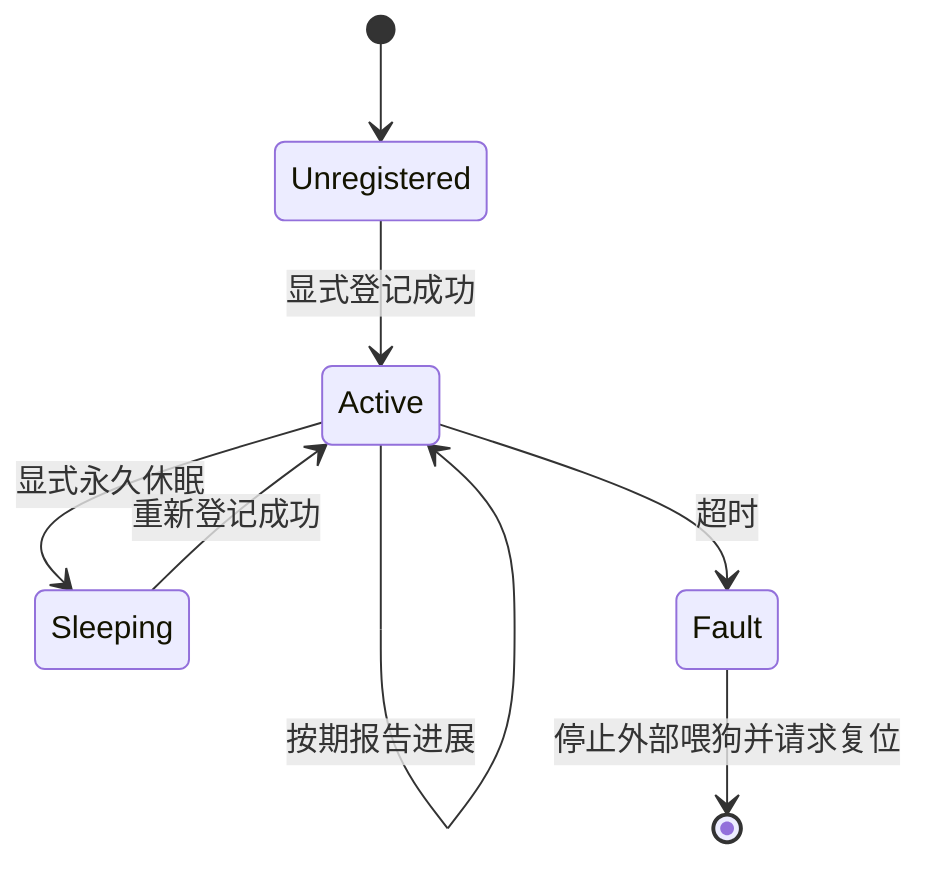

# 按需登记的多任务看门狗

状态：设计已确认，尚未实施。讨论记录见[边界问答](../.scratch/task-watchdog/discussion.md)，
决策见 [ADR 0009](adr/0009-opt-in-task-watchdog.md)。本页描述目标行为，当前代码仍使用旧健康喂狗路径。

## 管理职责

`app/status` 统一编排任务监控、RAM 诊断、故障锁存及重启动作。
多通道超时检测优先使用当前 Zephyr 的 Task Watchdog，GPIO 喂狗继续由底层模块执行。
任务通过 `status` 接口显式登记和报告进展；通用模块后续通过应用注册的健康回调接入，保持与产品头文件分离。

GPIO 喂狗周期与任务超时时间分别配置。任务期限由调用者在登记时传入，
登记容量通过 Kconfig / `.conf` 手动配置，不按固件类型预设任务清单。
本轮不扫描线程，不维护应启动任务清单，也不检查登记遗漏。

## 喂狗规则

| 条件 | 外部喂狗与复位行为 |
| --- | --- |
| 没有活动登记项，且没有已锁存故障 | 持续喂外部看门狗。 |
| 活动登记项均在各自期限内 | 持续喂外部看门狗。 |
| 某任务显式进入监控永久休眠 | 仅取消该任务的超时计时，记录休眠标志。 |
| 任一活动登记项超时 | 锁存首个故障和任务身份，停止外部喂狗，然后请求软件冷复位。 |
| 已锁存故障后登记项变成零 | 保持停喂和复位流程，不能通过删除或重新登记清除故障。 |

底层保持定期 GPIO 边沿输出；`status` 决定何时停止。
没有活动登记项时仍允许正常喂狗，因此旧主循环 1500 ms 进展超时和应用中隐式的 DP 活性检查，
不能继续作为未登记任务的看门狗约束。实现时移除或解耦这些隐式监控路径。
明确的初始化失败、GPIO 故障等既有整机故障策略仍可锁存故障并停喂。
远端设备离线保持 ADR 0008 的业务降级语义，不直接判定任务失去响应。

## 任务生命周期



登记成功即开始计时。正常运行中的重复登记返回错误，避免用登记操作代替心跳。
永久休眠保留明确标志，例如 `STATUS_TASK_SLEEP_FOREVER`；该状态的心跳不自动恢复监控，
必须重新登记，登记失败时保持未启用状态。
永久休眠只改变监控关系，任务自身的休眠、唤醒或退出由原业务编排。
已锁存超时后，永久休眠、迟到心跳或重新登记均不能撤销故障。

有限休眠继续计入时限：

```text
超时预算 ≥ 正常休眠时间 + 最长处理时间 + 调度余量
```

等待事件的工作线程后续采用有界等待，在处理或确认空闲后报告进展；
工作队列由同一队列执行健康探针。探针必须在被监控的执行上下文中运行。
长处理、NVS 操作、升级解包等允许时间由调用者预算覆盖，不增加自动延长期限或自动停用机制。

## 接口形态

计划在 `app/status/task_watchdog/` 内提供能力，接口围绕显式登记、心跳、永久休眠和查询组织：

```c
status_register(&task, &config); /* 配置包含常驻名称和允许的最大心跳间隔。 */
status_feed(&task);
status_sleep_forever(&task);
status_register(&task, &config); /* 永久休眠后的恢复。 */
```

调用者持有常驻的任务上下文和名称，检查登记结果；底层通道编号由 `status` 管理。
接口具体声明在实施规格中落实，休眠标志及登记失败语义保持本页约定。

## 诊断与故障处理

RAM 中保存当前登记状态、任务名、期限、最后心跳、永久休眠标志和首个超时任务，提供查询。
普通 RAM 记录在重启后清空，不提供跨重启保存；故障路径不写 Flash。

Task Watchdog 超时回调运行在计时器中断上下文，实现中只执行安全的故障锁存、停喂和复位。
不从该回调直接调用包含 LED 操作的完整 `status_fail()`，也不等待其他任务、工作队列或日志落盘。
当前 GPIO 看门狗封装不是 Zephyr watchdog device，不能直接作为 Task Watchdog 的原生硬件 fallback。
这里的外狗保障是：故障回调先停喂，即使后续软件复位未完成，也保持停喂。
保留 MCUboot 将 PC13 浮空禁用外狗、应用重新启用的板级交接。

## 本轮与后续接入

本轮仅确定按需监控能力，不给现有任务增加登记、心跳、健康探针或通用进展回调。
不新增任务就绪清单，也不把未登记任务加入镜像确认的额外条件；既有明确业务确认条件保持。

后续按用户需要逐项接入：主采样循环、DP 样本与业务处理、每条 CO 总线、TR 接收与配置队列，
以及启用 IAP 时的升级工作线程。Zephyr 内部线程暂不自动纳入。

## 实施验收

- 零活动登记项持续喂狗；全部永久休眠时同样持续喂狗。
- 多任务独立期限互不代喂，任一超时触发停喂及软件复位。
- 正常休眠和事件空闲不误报；迟到心跳不能恢复已锁存故障。
- 永久休眠标志、重新登记、重复登记、容量不足及无效参数符合约定。
- RAM 查询反映当前状态及首个故障；不产生跨重启存储记录。
- 现有任务保持未登记，不产生隐藏的主循环或 DP 任务超时约束。
- 区分主机/native 验证与实板 GPIO 波形、外部看门狗和复位链验证。

底层公开能力参考 [Zephyr Task Watchdog](https://docs.zephyrproject.org/latest/services/task_wdt/index.html)。
