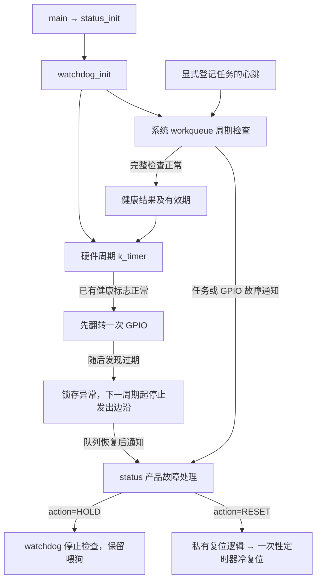

# 工作队列检查与硬件看门狗

当前方案替代之前的两个 k_timer 和最早期限检查方案。保留一个硬件周期 k_timer，任务检查改到系统 workqueue。
定时器通过原子控制状态与 32 位健康截止时间运行，不获取任务监控共享锁；故障经 Zephyr 消息队列交接。
完整接口、配置及并发契约见[模块说明](../modules/watchdog/README.md)。

硬件周期来自设备树 feed-interval-ms；软件周期来自 WATCHDOG_CHECK_INTERVAL_MS；启动宽限和健康有效期固定为三倍软件周期。
默认硬件 10 ms、软件 100 ms、有效期 300 ms。检查完成且全部正常才续期，心跳和工作开始不续期。
没有登记任务时仍检查工作队列自身是否正常运行；已登记任务按各自的绝对期限检查，检测有检查周期及队列调度延迟。
生产 main、DP、CO、TR、IAP 保持不自动登记，不恢复隐式主循环或 DP 活性约束。

软件监控是模块固定能力，watchdog_init 成功后始终运行；仅外部喂狗由 WATCHDOG_EXTERNAL 控制。debug.conf 只关闭外部喂狗，软件检查及显式 RESET 仍有效。
工作队列阻塞超过有效期时，硬件定时器本轮先喂狗，再锁存 CHECK 故障，下一周期起停喂，不在 ISR 调用 status；外部芯片负责兜底。
仅软件配置无法在系统队列卡死期间主动处置，只会在队列恢复后发现过期，这与带外部硬件的能力不同。
过期结果不能在恢复检查时重新续期；HOLD 显式关闭检查后可保留喂狗，但诊断不清除。

status 只负责整机状态、产品处理与 LED。它不轮询硬件错误、不解析引脚、不调用 sys_reboot；
故障回调只读，动作由上报方或 watchdog 内部决定，返回后由 watchdog 执行 HOLD 或延时 RESET。其他模块统一调用 watchdog_report_fault(error, description, action, reset_delay_ms)，
无需引用 status 或指定整机阶段；主动上报同步回调，内部监控故障仍在 workqueue 通知。
内部任务超时、健康过期及运行中的 GPIO 故障统一按 RESET/200 ms，不以任务登记推断业务阶段。初始化函数直接返回错误，应用主动上报 HOLD；不自动登记主循环或其他任务。
通用模块不依赖 watchdog，任务登记由应用侧负责。
watchdog_fault_get 统一查询最近故障，status 不复制故障或业务诊断；内部监控锁存不因普通上报覆盖而恢复。
watchdog 不依赖产品的协议/IAP 接口。

测试覆盖外部喂狗开/关、三倍有效期、首次检查宽限、队列阻塞恢复、迟到心跳、HOLD、GPIO 故障和直接复位。
结果见[验收记录](../.scratch/watchdog-workqueue/validation.md)。主机/native 测试不替代实板波形和复位链验证。

复位只通过四参数 watchdog_report_fault 的 RESET 动作发起；第四参数为 uint32_t 毫秒，0 立即复位，非零使用私有一次性 k_timer。其他动作忽略延时，重复复位请求只能提前不能推迟。
延时期间关闭任务监控并保留可用喂狗，到期停喂后调用底层复位；日志和参数保存不作完成保证。
对应验收见 [.scratch/watchdog-delayed-reset](../.scratch/watchdog-delayed-reset/issues/01-timer.md)。

控制逻辑已收敛为单一原子模式：未初始化、监控、故障待处理、留驻、等待复位、停止。模式统一控制任务检查和 GPIO 喂狗，GPIO 失败单独锁存；不再维护 registered/checking/stopped/notified/reset_started 或第二份内部故障缓存。
定时器/任务发现故障后入队，工作队列消费一次并执行动作；查询只查看快照，不消费事件。事件序号仅用于诊断先后顺序，不参与喂狗控制。
简化设计与本轮验收见 [.scratch/watchdog-simplify](../.scratch/watchdog-simplify/issues/01-simplify.md)。

不再提供软件监控配置开关，检查周期仍由 WATCHDOG_CHECK_INTERVAL_MS 配置。调试需要暂停时可显式调用 watchdog_stop(WATCHDOG_STOP_MONITOR)，复位后恢复。

任务检查的锁仅覆盖链表扫描、必要的故障快照交接和健康续期；事件消费按条使用短临界区完成出队与最近诊断更新，防止查询漏报。故障模式判断、回调和工作调度均在锁外执行；任务心跳超时也在解锁后调度通知，不增加额外待处理状态。
