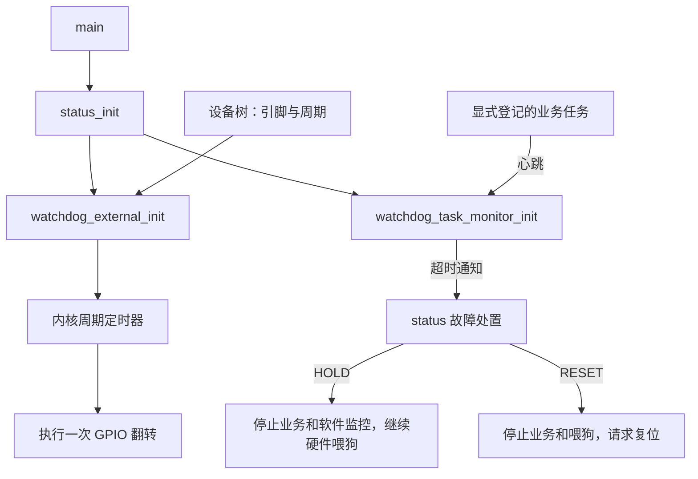

# 软件任务监控与外部看门狗

当前决定取代 ADR 0009 中任务监控归应用并共享状态锁的实现，保留显式登记和故障契约。

## 模块边界

`modules/watchdog/src/watchdog.c` 在同一文件内分段实现软件任务期限与外部 GPIO 周期喂狗。
软件监控不依赖物理后端、应用阶段或产品设备树。硬件配置由独立的 app,gpio-watchdog 设备树节点描述，模块仅在 status_init 显式调用 watchdog_external_init 时读取配置并开始喂狗。
`app/status/status.c` 显式初始化硬件喂狗和软件超时通知、查询硬件错误，并选择 HOLD 或 RESET。status 的公开头 inc/status.h 不再提供任务接口。
详细接口和上下文约束见[模块说明](../modules/watchdog/README.md)。

```c
#include <watchdog/watchdog.h>
static struct watchdog_task task;
static const struct watchdog_task_config config = {
    .name = "worker",
    .timeout_ms = 1000,
};
/* 系统初始化时由 status 安装超时回调，任务自行选择是否接入。 */
watchdog_task_register(&task, &config);
watchdog_task_feed(&task);
watchdog_task_sleep_forever(&task);
```

当前生产 main、DP、CO、TR、IAP 不自动登记，不恢复隐式主循环或 DP 活性约束。
无固定任务容量、无动态分配，不依赖 Zephyr TASK_WDT。任务名称和上下文由调用方常驻持有。
普通休眠计入预算；永久休眠移出活动链表，重新登记恢复。活动链表在线程登记/心跳时按绝对期限排序，单次定时器只检查表头，
任一任务超时即锁存首个 RAM 快照，停止期限调度，拒绝后续心跳/登记。
监控锁内修改和复制状态，释放锁后通知 status；模块不访问 status 状态锁。

## 启动与执行边界



没有喂狗线程，不在 POST_KERNEL 自动启动。设备树绑定与初始化时机独立；应用选择时机，模块解释硬件配置。
初始化前不触碰喂狗引脚，初始化失败不重试。喂狗仅表示定时器仍能执行，未登记的启动流程或任务不受软件监控保护。
本轮不自动增加启动监控或生产任务登记；若后续需要检测初始化卡住，应显式登记启动任务并定义期限。

## 故障策略

启动阶段超时选择 HOLD，运行阶段选择 RESET。HOLD 停止业务和软件监控，外部喂狗继续；
RESET 停止软件监控及硬件喂狗并请求复位。迟到心跳与后续 CONTINUE 不恢复业务。
物理 GPIO 错误由 status 独立查询并请求复位，不混入软件超时快照；查询不跨复位保存。
超时回调可能处于 ISR，锁外同步执行应用的短小故障处置，不新增工作线程。
RESET 先停止硬件喂狗，再关闭协议/IAP 准入；不等待系统 workqueue 获得调度。
日志使用 Zephyr 延后且非阻塞的模式，不增加自定义日志队列；LED 与辅助维护继续由系统 workqueue 执行。
复位请求先于 LED/维护工作提交，测试复位钩子返回时才继续提交辅助工作。
两个 k_timer 没有逐对象优先级，回调共享时钟中断路径，因此控制回调耗时而非设置定时器优先级。


## 配置与调试

| WATCHDOG_SOFTWARE | WATCHDOG_EXTERNAL | 行为 |
| --- | --- | --- |
| y | y | 软件任务期限和外部喂狗均启用 |
| y | n | 软件检测保持，外部 GPIO 不初始化 |
| n | y | 只周期喂外部看门狗 |
| n | n | 两者均不初始化 |

prj.conf 正常启用两项；conf/debug.conf 关闭两项。移除 APP_DEBUG_SKIP_WATCHDOG 与 WATCHDOG_MONITOR。
关闭外部选项只代表应用不配置/翻转喂狗引脚，不主动关闭硬件芯片。当前板子沿用 MCUboot 将 PC13 浮空的交接；
真实硬件能否停在断点不复位仍需实板验证。显式 STATUS_ACTION_RESET 不受两个配置改写。

## 验证

任务测试逐场景使用新 native 进程，覆盖独立期限、休眠/恢复、并发快照、HOLD 持续喂狗和超时复位。
四种配置分别编译并检查初始化效果。native 测试不代替外部芯片、GPIO 波形和真实复位链验证。
本轮结果见[验收记录](../.scratch/watchdog-short-isr/validation.md)；此前记录保留在 Git 历史与原 scratch 目录。
