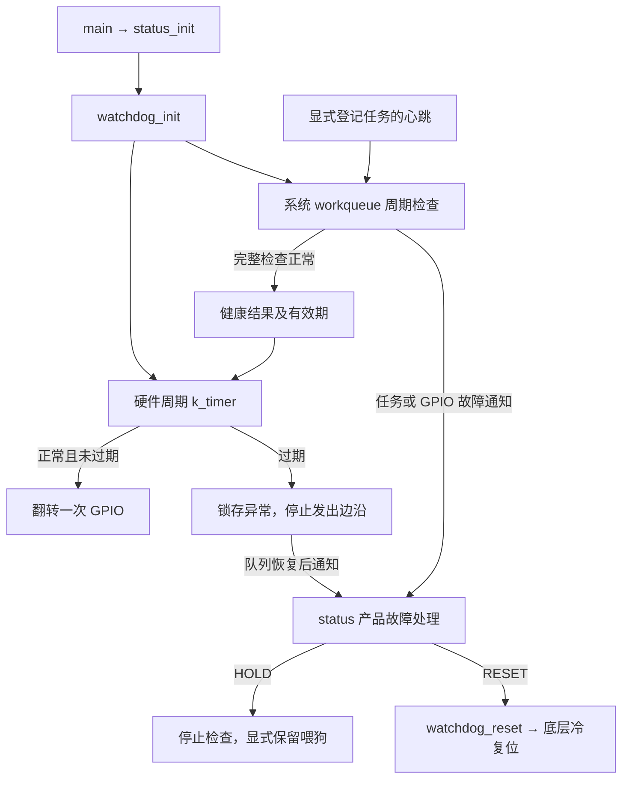

# 工作队列检查与硬件看门狗

当前方案替代之前的两个 k_timer 和最早期限检查方案。保留一个硬件周期 k_timer，任务检查改到系统 workqueue。
完整接口、配置及并发契约见[模块说明](../modules/watchdog/README.md)。

硬件周期来自设备树 feed-interval-ms；软件周期来自 WATCHDOG_CHECK_INTERVAL_MS；启动宽限和健康有效期固定为三倍软件周期。
默认硬件 10 ms、软件 100 ms、有效期 300 ms。检查完成且全部正常才续期，心跳和工作开始不续期。
没有登记任务时仍检查工作队列自身是否正常运行；已登记任务按各自的绝对期限检查，检测有检查周期及队列调度延迟。
生产 main、DP、CO、TR、IAP 保持不自动登记，不恢复隐式主循环或 DP 活性约束。

软件/硬件开关独立；debug.conf 关闭两项，但显式 watchdog_reset 仍会复位。
工作队列阻塞超过有效期时，硬件定时器锁存 CHECK 故障并停喂，不在 ISR 调用 status；外部芯片负责兜底。
仅软件配置无法在系统队列卡死期间主动处置，只会在队列恢复后发现过期，这与带外部硬件的能力不同。
过期结果不能在恢复检查时重新续期；HOLD 显式关闭检查后可保留喂狗，但诊断不清除。

status 只负责整机状态、产品故障动作与 LED。它不轮询硬件错误、不解析引脚、不调用 sys_reboot；
通过故障回调选择 HOLD 或调用 watchdog_reset。其他模块统一调用 watchdog_report_fault(error, description, action)，
无需引用 status 或指定整机阶段；主动上报同步回调，内部监控故障仍在 workqueue 通知。watchdog 不依赖产品的协议/IAP 接口。

本轮测试覆盖四种开关、三倍有效期、首次检查宽限、队列阻塞恢复、迟到心跳、HOLD、GPIO 故障和直接复位。
结果见[验收记录](../.scratch/watchdog-workqueue/validation.md)。主机/native 测试不替代实板波形和复位链验证。
