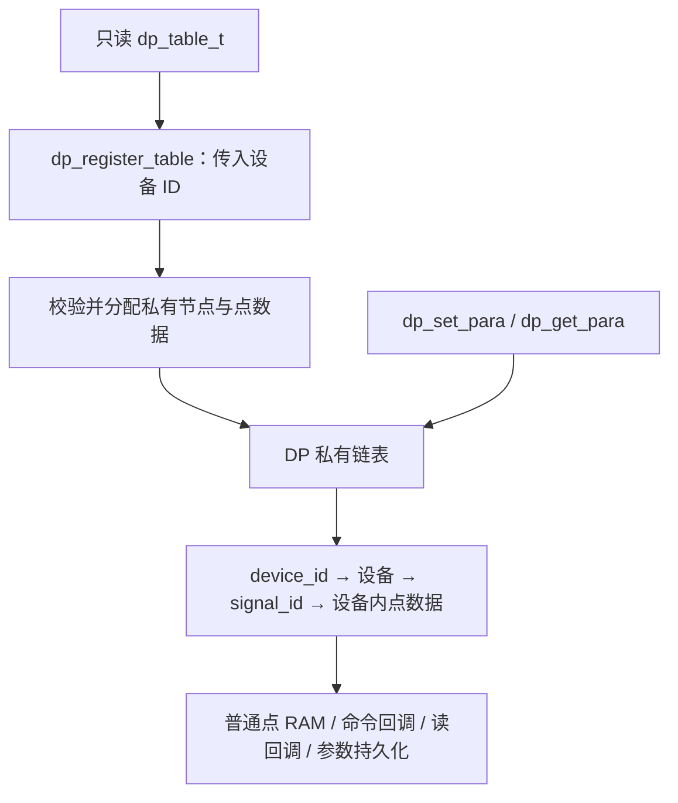

# dataprocess

[文档导航](../../docs/README.md) · [模块总览](../README.md)

DP 负责设备点表登记、同步点值读写和本机参数持久化。应用只提供只读定义，
私有链表及运行数据由模块维护。没有业务线程、队列、定时器或整机停运状态。

## 三个主接口

包含 `<dataprocess/points.h>`：

```c
int dp_register_table(uint16_t device_id, const dp_table_t *table);
int dp_set_para(uint16_t device_id, uint16_t signal_id, uint8_t size, const uint8_t *bytes);
int dp_get_para(uint16_t device_id, uint16_t signal_id, uint8_t capacity, uint8_t *bytes);
```

```c
static const dp_point_def_t points[] = {
    {.signal_id = 1, .size = 2, .type = DP_TYPE_U16},
    {.signal_id = 2, .size = 2, .type = DP_TYPE_U16,
     .flags = FLAG_PERSISTENCE | FLAG_RANGE_CHECK,
     .data = {.default_value.u16 = 500, .minimum.u16 = 100, .maximum.u16 = 1000}},
};
static const dp_table_t table = {
    .points = points,
    .point_count = ARRAY_SIZE(points),
};

/* 同表多设备，各自持有独立点值。 */
dp_register_table(1, &table);
dp_register_table(2, &table);
```

在启动线程完成全部登记后再开始读写；登记与业务不并发。设备 ID 必须非零且唯一，
同表信号 ID 也须非零且唯一。重复返回 `-EEXIST`。模块复制表描述字段，表描述可以
临时存在；行数组及数组初值等引用数据必须常驻只读。

登记先校验，再一次申请私有节点及该设备的全部点数据，填入默认值，最后挂入链表。
失败不发布设备，不消耗参数预算；申请失败返回 `-ENOMEM`，可重试。
没有最大表数、全局状态槽或跨表点下标。参数数量跨设备累计检查，挂载 NVS 后
禁止新增持久参数（`-EBUSY`）。



## 类型与点值

| 类型 | 内容 |
| --- | --- |
| `dp_point_def_t` | signal_id、size、flags、type、write_callback、read_callback、data |
| `dp_table_t` | points、point_count；无设备 ID、链表或运行数据 |
| `dp_key_t` | device_id、signal_id |
| `dp_value_t` | 联合体：bytes、words、u8、u16、s16、u32、s32、f32 |
| `dp_point_data_t` | value、uint32_t updated_at_s |
| `dp_param_status_t` | 参数存储就绪、错误、序号等状态 |

联合体不记录类型，实际类型和有效字节数由点表定义；scalar 成员为原生数值视图。
`words` 保持低字在前；对外字节流按低字节在前编码。`f32` 仅是访问视图，当前没有
浮点点表支持。有效类型为 U8/U16/S16/U32/S32、STRING/BYTES/WORDS。

所有读写在线程同步执行，ISR 返回 `-EWOULDBLOCK`。写长度必须匹配；读容量必须
足够，成功返回传入容量。普通点更新值；常量返回 `-EACCES`；命令点仅调用 `write_callback`，
不保存触发值。`read_callback` 只输出 `dp_value_t`，成功时 DP 保存生成快照及时间。

标志保留 `FLAG_CONSTANT`、`FLAG_PERSISTENCE`、`FLAG_RANGE_CHECK`、
`FLAG_READ_CALLBACK`、`FLAG_NO_RESTORE`。常量不支持写回调，参数不支持读写回调。
未启用范围检查时按类型范围校验。`data.default_value/minimum/maximum` 为字面值联合体，
初值大于 4 字节时使用 `.array` 常驻只读指针，NULL 表示全零。

## 更新时间

`updated_at_s` 为 UNIX 秒、UTC，0 表示未知。不再保存 generation、error、quality。
DP 使用 Zephyr `SYS_CLOCK_REALTIME`，墙钟偏移为零视为未校时；不以 uptime 代替日期。
当前产品没有 RTC/NTP 授时，时间默认保持 0。未来由应用通过
`sys_clock_settime(SYS_CLOCK_REALTIME, &timespec)` 校时，不需要新增 DP 校时接口。

- 默认值、常量、从 NVS 启动恢复的历史值：时间为 0。
- 普通点写入、参数成功保存/接受同值写入、恢复默认：记录当前秒。
- 读回调成功：记录快照生成时间；普通读取不改变时间。
- 失败：原值和时间不变；命令点不保存触发值或更新时间。
- 时间小于等于 0 或超出 UINT32_MAX：记为 0，不回绕；可表示到 2106 年。
- 时间不写入 NVS；校时前的数据不补写时间。同秒更新相同，校时可能使时间后退。
  超时判断应使用 monotonic 时钟。

## 参数分区与维护

启用 DP 必须提供 `dp-params` 别名，指向启用的固定分区，否则编译失败：

```dts
/ {
    aliases { dp-params = &dp_params; };
};
/* 以下分区位于 Flash 的 fixed-partitions 节点内。 */
dp_params: partition@10000 {
    label = "dp-params";
    reg = <0x10000 0x4000>;
};
```

NVS 首次参数访问时挂载。参数直接使用设备点数据作为缓存，没有第二份点状态。
同步提交成功后才覆盖值；读写按 `(device_id, signal_id)` 保存，NVS 哈希键、存储
类型编码、版本及提交镜像格式保持不变。类型/宽度不兼容时按既有策略清空参数分区，
I/O 错误停写；应用采样周期读取失败时回退到默认值。

`params.h` 额外保留恢复默认 `dp_params_restore()` 和状态查询 `dp_params_get_status()`，
供产品命令/状态点及 IAP 使用。没有刷新任务、延后保存或取消冻结接口。

## 实现与容量

`points.c` 负责三个主接口、校验、私有设备登记及点数据；`params.c` 负责本机参数；
`parameter_store.c` 负责 NVS 记录及提交恢复。内部类型只在 `src/` 头文件中可见。
公共点表类型集中在 points.h，旧 reference_tables.h 和旧类型名已移除。

`DP_POINT_WORDS` 限定每点联合体容量，`DP_PARAMS_MAX_COUNT` 限定参数数量，
`DP_PARAMS_TRANSACTION_BYTES` 限定提交镜像。系统堆预算由
`HEAP_MEM_POOL_ADD_SIZE_DATAPROCESS` 与 `HEAP_MEM_POOL_ADD_SIZE_DP_PARAMS` 提供。
细节见[内存管理](../../docs/memory-management.md)。
