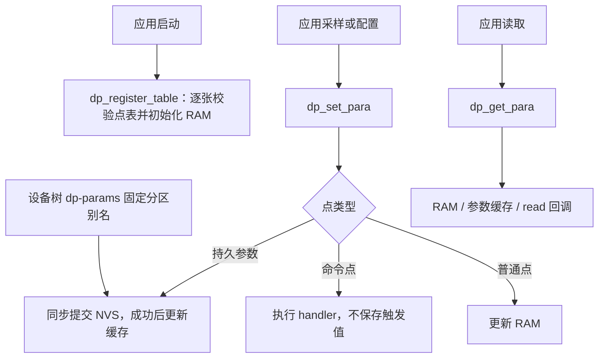

# dataprocess

[文档导航](../../docs/README.md) · [模块总览](../README.md)

DP 负责登记点表、同步读写和本机 NVS 持久化。整机阶段、停运和复位由应用负责。

## 当前结构



## 三个主接口

统一包含 `<dataprocess/points.h>`：

```c
int dp_register_table(struct dp_table *table);
int dp_set_para(uint16_t dev_id, uint16_t sig_id, uint8_t size, const uint8_t *bytes);
int dp_get_para(uint16_t dev_id, uint16_t sig_id, uint8_t capacity, uint8_t *bytes);
```

启动线程逐张登记表，全部完成后再开始业务读写；登记与业务读写不并发。
模块要求设备树提供 `dp-params` 别名，指向启用的 `fixed-partitions` 子分区；
缺少别名或目标错误会编译失败，无须应用传入分区 ID。

```dts
/ {
    aliases {
        dp-params = &dp_params;
    };
};
/* 位于 Flash 的 fixed-partitions 节点内；地址和大小由板级决定。 */
dp_params: partition@10000 {
    label = "dp-params";
    reg = <0x10000 0x4000>;
};
```

```c
static const DM_SIG_CFG_S rows[] = { /* 产品测点 */ };
static struct dp_point_state states[ARRAY_SIZE(rows)];
struct dp_table local_table = {
    .device_id = 1,
    .points = rows,
    .point_count = ARRAY_SIZE(rows),
    .states = states,
};

int protocol_init(void)
{
    return dp_register_table(&local_table);
}
```

测点行数组只读；表描述和状态数组可写，三者都须常驻。`states` 长度必须与
`points` 相同，按 `ARRAY_SIZE(rows)` 定义；不同表各自提供独立数组，不能共用或重叠。
登记后应用不再修改表描述、行定义、状态或 next，只通过 DP 读写接口访问数据。

每张表使用不同 `device_id`，重复返回 `-EEXIST`；不同表可以复用 `sig_id`。
DP 校验整张表后初始化 states，再将表挂入单向链表；失败不改变状态数组或已登记表。
无全局表槽位、全局点下标、最大表/点数量配置，也没有点值动态分配。
每个状态直接包含 `DP_POINT_WORDS` 字点值，使用更多静态 RAM 换取简单寻址。
持久参数数量仍按所有表累计检查；参数挂载后不能增加持久参数（`-EBUSY`）。

```text
DP 链表 → table B → table A → NULL
             │         │
             ├ points  ├ points   只读定义
             └ states  └ states   各表独立状态及点值

读取/写入：device_id → 表 → sig_id → 本表 states[i]
```

读写均在线程上下文同步执行，ISR 返回 `-EWOULDBLOCK`。字节序为低字节在前；
写长度须与点表一致，读容量须足够。写成功返回 0；读成功保留原约定返回传入容量。
不保留旧接口别名。

## 点表与回调

`reference_tables.h` 只定义 `DM_SIG_CFG_S` 等点表类型，没有运行函数：

- `sig_id`、`sig_size`、`data_type`：信号 ID、字节长度和类型。
- 无标志：普通 RAM 点；`FLAG_CONSTANT`：只读常量。
- `FLAG_PERSISTENCE`：本机持久参数；`FLAG_NO_RESTORE`：恢复默认时保留。
- `FLAG_RANGE_CHECK`：按行内 min/max 校验，否则使用类型范围。
- `handler`：命令写回调，校验后执行，触发值不写入数据池。
- `read`：读取时生成状态快照；`FLAG_READ_CALLBACK` 要求提供该回调。
- `data`：初值、最小值、最大值。数组初值指针必须常驻，NULL 表示全零。

参数不能绑定读写回调，常量不能绑定写回调。

## 参数维护

`params.h` 只额外提供现有产品实际需要的两项：
`dp_params_restore(device_id)` 恢复默认，`dp_params_get_status()` 查询存储状态。
这些由产品命令点、状态点和 IAP 的复位准备调用；普通业务只使用三个主接口。

NVS 首次访问时挂载。读写按 `(dev_id, sig_id)` 保存，记录及提交镜像格式保持不变。
写入失败返回错误，不覆盖已经确认的缓存。存储初始化失败由状态报告，应用读取
采样周期失败时使用产品默认值。不兼容格式只清空参数分区；I/O 错误不清空。
所有参数同步落盘，没有延后保存、刷新任务或冻结/取消复位状态。

## 文件职责

| 文件 | 职责 |
| --- | --- |
| `points.c` | 三个主接口、点表校验、普通点值和回调 |
| `params.c` | 参数缓存、恢复默认、延迟挂载与同步保存 |
| `parameter_store.c` | NVS 记录、提交镜像及掉电恢复 |
| `src/dp_internal.h`、`src/parameter_store.h` | 模块内部实现接口 |

容量通过 `DP_POINT_WORDS` 配置单点最大字数；`DP_PARAMS_MAX_COUNT` 和
`DP_PARAMS_TRANSACTION_BYTES` 限制持久参数数量和提交镜像。
参数缓冲仍在首次访问时分配，点表和状态不占系统堆；见[内存管理](../../docs/memory-management.md)。
