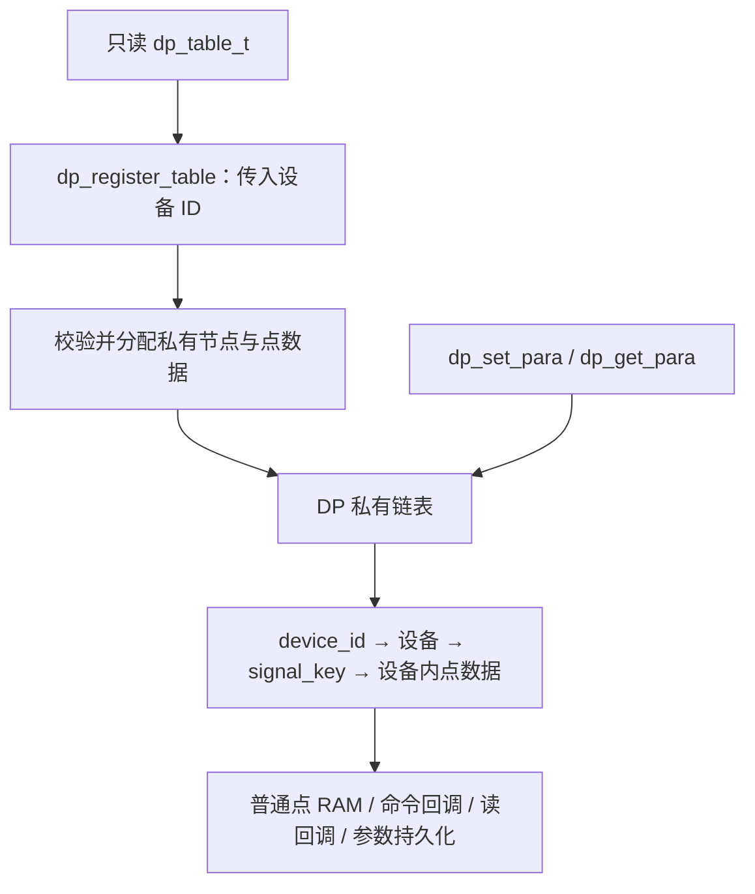

# dataprocess

[文档导航](../../docs/README.md) · [模块总览](../README.md)

DP 负责设备点表登记、同步点值读写和本机参数持久化。应用只提供只读定义，
私有链表及运行数据由模块维护。没有业务线程、队列、定时器或整机停运状态。

## 初始化与三个点表接口

包含 `<dataprocess/points.h>`：

```c
int dp_init(void);
int dp_register_table(uint16_t device_id, const dp_table_t *table);
int dp_set_para(uint16_t device_id, uint16_t signal_key, uint8_t size, const uint8_t *bytes);
int dp_get_para(uint16_t device_id, uint16_t signal_key, uint8_t capacity, uint8_t *bytes);
```

```c
static const dp_point_config_t points[] = {
    {.signal_key = 1, .size = 2, .type = VALUE_TYPE_U16},
    {.signal_key = 2, .size = 2, .type = VALUE_TYPE_U16,
     .flags = DP_POINT_FLAG_PERSISTENT | DP_POINT_FLAG_CHECK_RANGE,
     .data = {.initial.u16 = 500, .minimum.u16 = 100, .maximum.u16 = 1000}},
};
static const dp_table_t table = {
    .points = points,
    .point_count = ARRAY_SIZE(points),
};

/* 先挂载，再逐表登记；同表多设备各自持有独立点值。 */
dp_init();
dp_register_table(1, &table);
dp_register_table(2, &table);
```

在启动线程完成全部登记后再开始读写；登记与业务不并发。设备 ID 必须非零且唯一，
同表信号 ID 也须非零且唯一。重复返回 `-EEXIST`。模块复制表描述字段，表描述可以
临时存在；行数组及数组初值等引用数据必须常驻只读。

登记先做入参、大小及重复键检查，然后分配节点及点数据，再逐点校验和加载：
非持久点复制初值，持久点逐点加载历史值；
无记录时使用初值并按本表批量保存，全部成功后挂入链表。
失败不发布设备，不消耗参数预算；申请失败返回 `-ENOMEM`，可重试。
没有最大表数、全局状态槽或跨表点下标。参数数量跨设备累计检查；
启动线程可以继续登记后续持久点表，业务开始后不再登记。



## 类型与点值

| 类型 | 内容 |
| --- | --- |
| `dp_point_config_t` | signal_key、size、flags、type、write_callback、read_callback、data |
| `dp_table_t` | points、point_count；无设备 ID、链表或运行数据 |
| `value_t` | 联合体：bytes、words、u8、u16、s16、u32、s32、f32 |
| `dp_point_data_t` | value、uint32_t updated_at_s |
| `dp_param_status_t` | 参数存储就绪、错误、序号等状态 |

联合体不记录类型，实际类型和有效字节数由点表定义；scalar 成员为原生数值视图。
`words` 保持低字在前；对外字节流按低字节在前编码。`f32` 仅是访问视图，当前没有
浮点点表支持。有效类型为 U8/U16/S16/U32/S32、STRING/BYTES/WORDS。

所有读写在线程同步执行，ISR 返回 `-EWOULDBLOCK`。写长度必须匹配；读容量必须
足够，成功返回传入容量。读写回调成功后校验最终值；普通点更新 RAM，持久参数同步提交 NVS。`read_callback` 接收当前值的副本，可修改输出；成功且通过点值校验后，DP 保存快照及时间。

标志保留 `DP_POINT_FLAG_PERSISTENT`、`DP_POINT_FLAG_CHECK_RANGE`、
`DP_POINT_FLAG_SKIP_RESTORE`。持久参数支持读写回调。读回调仅由非空指针启用。
未启用范围检查时按类型范围校验。`data.initial/minimum/maximum` 与运行值统一使用公共 `value_t`，定义于 `<common/value.h>`，
容量由 `CONFIG_COMMON_VALUE_WORDS` 配置；
初值统一使用内嵌成员（如 `.u16`、`.words`、`.bytes`），不使用 `.array` 外部指针。

## 更新时间

`updated_at_s` 为 UNIX 秒、UTC，0 表示未知。不再保存 generation、error、quality。
DP 使用 Zephyr `SYS_CLOCK_REALTIME`，墙钟偏移为零视为未校时；不以 uptime 代替日期。
当前产品没有 RTC/NTP 授时，时间默认保持 0。未来由应用通过
`sys_clock_settime(SYS_CLOCK_REALTIME, &timespec)` 校时，不需要新增 DP 校时接口。

- 默认值、从 NVS 启动恢复的历史值：时间为 0。
- 普通点写入、参数成功保存/接受同值写入、恢复默认：记录当前秒。
- 读回调成功：记录快照生成时间；普通读取不改变时间。
- 失败：原值和时间不变；回调最终值成功保存时记录更新时间。
- 时间小于等于 0 或超出 UINT32_MAX：记为 0，不回绕；可表示到 2106 年。
- 时间不写入 NVS；校时前的数据不补写时间。同秒更新相同，校时可能使时间后退。
  超时判断应使用 monotonic 时钟。

## 参数分区与维护

启用 DP 必须提供 `dp-params` 别名，指向启用的固定分区，否则编译失败：

```dts
/ {
    aliases { dp-params = &dp_params; };
};
/* 以下分区位于 Flash 的 fixed-partitions 节点内。 */
dp_params: partition@10000 {
    label = "dp-params";
    reg = <0x10000 0x4000>;
};
```

dp_init() 先挂载 NVS 并恢复未完成事务，不依赖已登记点表。参数直接使用设备点数据作为缓存，没有第二份点状态。
同步提交成功后才覆盖值；读写按 `(device_id, signal_key)` 保存，NVS 哈希键、存储
类型编码、版本及提交镜像格式保持不变。挂载时存储格式不兼容沿用分区重置策略；
登记时单点类型/宽度不兼容则整表失败，不清空其他表的历史记录。
I/O 错误停写；应用采样周期读取失败时回退到默认值。

`params.h` 额外保留恢复默认 `dp_params_restore()` 和状态查询 `dp_params_get_status()`，
供产品命令/状态点及 IAP 使用。没有刷新任务、延后保存或取消冻结接口。

## 实现与容量

`points.c` 负责三个主接口、校验、私有设备登记及点数据；`params.c` 负责本机参数；
`parameter_store.c` 负责 NVS 记录及提交恢复。内部类型只在 `src/` 头文件中可见。
公共点表类型集中在 points.h，旧 reference_tables.h 和旧类型名已移除。

`DP_POINT_WORDS` 限定每点联合体容量，`DP_PARAMS_MAX_COUNT` 限定参数数量，
`DP_PARAMS_TRANSACTION_BYTES` 限定提交镜像。系统堆预算由
`HEAP_MEM_POOL_ADD_SIZE_DATAPROCESS` 与 `HEAP_MEM_POOL_ADD_SIZE_DP_PARAMS` 提供。
细节见[内存管理](../../docs/memory-management.md)。

读写回调共用 `dp_callback_t(const dp_callback_context_t *context)`。
上下文包含 device_id、signal_key、signal_index 和可修改的 value 指针。
signal_index 直接取查找命中的注册表行下标，从零开始；不额外存储索引或映射。
身份字段只读，value 只在本次同步回调期间有效；禁止保存上下文及其指针。
写回调接收输入副本，可以修改；成功后校验最终值并按点标志保存，不回写调用者字节。
读回调失败或返回越界值时，不修改点值、更新时间和调用者输出。
点表行类型为 `dp_point_config_t`，与运行数据 `dp_point_data_t` 区分。

## 配置所有权

DP 只保留 dp_point_config_t 配置行的只读指针，不接管其所有权。
应用须保证行数组及引用初值常驻到重启，禁止修改或释放，建议使用 static const。
表描述 dp_table_t 本身仍可临时存在。登记时校验配置；运行时直接读取原配置，
不生成第二份解析配置。登记和恢复默认直接复制配置初值；参数登记循环优先读取历史值，缺失时使用配置初值。
NVS 类型编码仅在参数层转换，记录格式及键保持不变。

回调上下文使用 `bool is_write` 区分方向：true 为写，false 为读，无额外枚举。
点标志类型为 dp_point_flags_t；PERSISTENT 表示持久化，SKIP_RESTORE 表示跳过恢复默认，
CHECK_RANGE 表示检查范围；保留标志的位值不变。
登记时复制 key、排序并检查相邻重复，临时内存为点数乘以 sizeof(uint16_t)，随后释放；
原点表顺序不变。排序使用 C 库 qsort，性能取决于库实现，不承诺最坏情况复杂度。

登记时 STRING/BYTES/WORDS 的范围检查标志、非持久点的 SKIP_RESTORE 标志仅记录
带 device_id/signal_key 的警告并忽略；不修改原配置。未启用范围检查时，上下限静默忽略。
类型长度不匹配、零长度、超容量、奇数 WORDS、非法类型、重复键、初值越界或启用的
数值范围颠倒仍拒绝登记。U8 上下限按 u8 读取，不检查联合体中无关的高字节。

DP 不控制写权限，原常量配置改为普通非持久点，可写且重启恢复初值。
调用方负责限制协议或业务写入；此变更不改变持久参数的键及编码。

## 回调与保存顺序

写入：解码输入 → 写回调（若存在）→ 校验最终值 → 根据 PERSISTENT 保存 NVS 或 RAM。
读取：取得已登记并恢复的当前值→ 读回调（若存在）→ 校验并保存 → 返回最终值。
没有读回调时只读当前值，不更新保存时间。回调在 DP 存储锁之外运行。
同值持久写复用去重机制，不重复写 Flash；回调、校验或保存失败时不更新缓存或输出。
回调引发的外部动作无法由 DP 回滚；同点并发回调沿用最后提交者覆盖语义，不构成原子读改写。
命令点不再是 DP 的特殊保存分支；应用恢复命令成功后将 value 置零，最终保存零值。

SKIP_RESTORE 仅影响显式 dp_params_restore()，不会跳过上电 NVS 恢复；
这类点上电仍读取已保存值，无历史记录时才使用初值。

上电持久参数仍优先恢复 NVS 历史值；没有记录时使用配置初值。

参数加载直接放在参数登记循环中，不再使用加载转发函数，也不在读写接口自动挂载。
登记前未调用 dp_init() 返回 -EACCES；初始化错误由调用方在启动阶段处理。
登记失败释放未发布节点并回退本表参数目录；缺失参数提交失败可能已落盘，
此时冻结继续写入，重启时由提交日志恢复，不承诺 Flash 事务副作用回滚。
